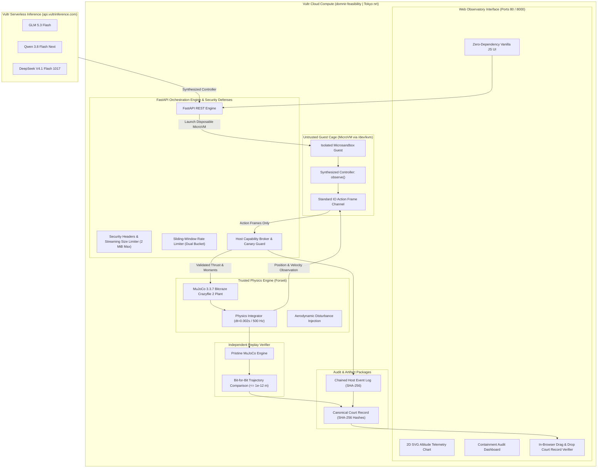
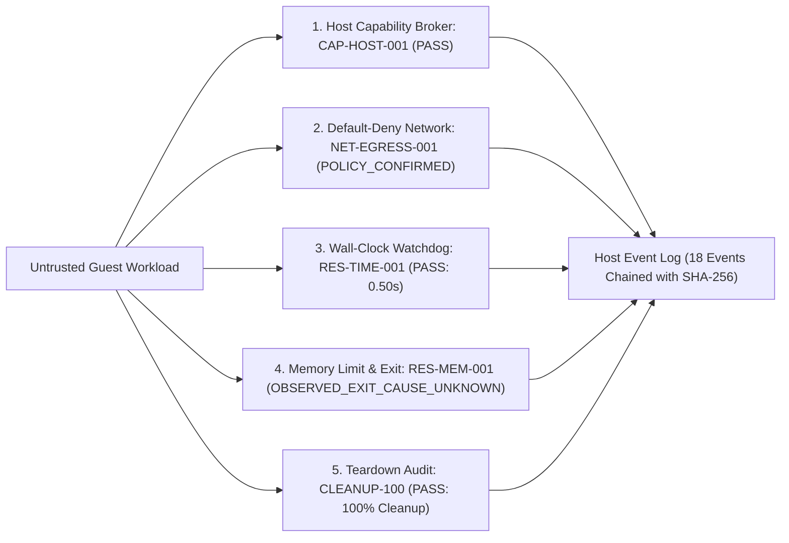

# Dómnir

**Adversarial Falsification and Containment Platform for AI-Generated Crazyflie 2 Flight Controllers**

*Built for Vultr Agent Rush Hackathon | Challenge 1: Blast Radius Zero*

---

## 1. Executive Summary

Dómnir is an adversarial falsification, physical qualification, and containment platform designed to evaluate AI-generated drone flight controllers before they touch physical hardware.

When Large Language Models generate drone control software, standard software unit tests cannot evaluate physical stability or airborne failure modes. Executing untrusted AI code directly on host systems risks arbitrary code execution, secret exfiltration, and infrastructure takeover.

Dómnir solves this with a **Blast Radius Zero** architecture:
1. **Host Never Runs Untrusted Code**: Controllers execute in disposable, hardware-isolated microVMs managed by Microsandbox with strict memory, CPU, network, and capability limits.
2. **Host-Owned Trusted Physics**: Only the trusted host simulation harness (Forseti) advances MuJoCo physics, clamps actuator limits, and records truth telemetry.
3. **Deterministic Replay Verification**: Trajectory actions are independently replayed in a fresh MuJoCo instance to verify bit-for-bit physical reproducibility (divergence <= 1e-12 m).
4. **Cryptographic Court Records**: Every trial emits an exportable Court Record with SHA-256 state hashing, a verifiable host event log chain, and multi-dimensional honest verdicts.
5. **Truthful Falsification**: Finite simulation sweeps identify counterexamples. Dómnir truthfully reports limitations and never misrepresents synthetic findings as real hardware certification.

---

## 2. Vultr Services and Infrastructure Architecture

Dómnir is built specifically for and powered exclusively by Vultr Cloud infrastructure:

### 2.1 Vultr Cloud Compute (Bare Metal / High-Frequency Compute)
- **Instance**: Vultr Cloud Compute High Frequency (`vx1-g-2c-8g-120s`, Tokyo region `nrt`).
- **Hardware Virtualization**: AMD EPYC processors with nested virtualization (`svm`) providing direct `/dev/kvm` hardware acceleration to the unprivileged `domnir` service user.
- **MicroVM Sandboxing**: Powers high-density, sub-second boot times for guest microVMs (`msb 0.7.13`), guaranteeing complete kernel and memory boundary isolation from the host.
- **Production Host Deployment**: The control plane, trusted MuJoCo physics engine, and public web interface run directly as a hardened `systemd` service (`domnir.service`) bound to public ports 80 and 8000.

### 2.2 Vultr Serverless Inference
- **Endpoint**: Dedicated Vultr Serverless Inference API at `https://api.vultrinference.com/v1`.
- **Zero GPU Idle Cost**: Eliminates dedicated GPU server costs by streaming token completions on demand.
- **Low Latency Code Synthesis**: Synthesizes verified Python controller algorithms in 1.8 to 2.4 seconds with minimal reasoning overhead.
- **Strict Boundary Security**: Serverless Inference API keys are stored server-side only in `.env` and are never exposed to the web browser or untrusted microVM guests.
- **Model Catalog Validation**: Dynamically validates model availability against Vultr model endpoints and detects provider/model mismatches.

### 2.3 The Three Vultr Serverless Models Supported
Dómnir exposes three distinct model families, selectable from both the public web UI and the REST API:

1. **GLM 5.3 Flash (`glm-5.3-flash`) [Default]**:
   - High instruction adherence, low latency, and rapid code generation for standard hover and altitude tracking.
2. **Qwen 3.8 Flash Next (`qwen3.8-flash-next`)**:
   - Advanced mathematical and state reasoning for non-linear recovery and aggressive aerodynamic disturbance envelopes.
3. **DeepSeek V4.1 Flash 1017 (`deepseek-v4.1-flash-1017`)**:
   - Highly compact, mathematically constrained Python synthesis with tight variable scoping and minimal token consumption.

---

## 3. End-to-End System and Deployment Architecture

The system enforces strict unidirectional trust boundaries between untrusted AI controllers and host infrastructure.



---

## 4. The Autonomous Agent: Real Tasks and Use Cases

Dómnir automates the real-world engineering workflow of qualifying AI control software for physical aerial robotics:

1. **Mission Specification**: The user or orchestrator defines flight parameters: target altitude ($z = 0.10$ m), allowable tolerance, mission duration, disturbance force bounds, and time step ($dt = 0.002$ s).
2. **Autonomous Code Synthesis**: The agent queries Vultr Serverless Inference (`glm-5.3-flash`, `qwen3.8-flash-next`, or `deepseek-v4.1-flash-1017`) with a domain prompt instructing the LLM to output a clean, bounded Python `observe(obs)` function.
3. **Static AST Analysis & Hashing**: The controller is parsed with Python AST, validated for arity, checked against the 32 KiB code size ceiling, and fingerprinted with SHA-256.
4. **Isolated MicroVM Execution**: The host provisions a disposable microVM using Microsandbox on Vultr Cloud Compute with nested KVM. The untrusted code never touches host files, secrets, or MuJoCo pointers.
5. **Hardware-in-the-Loop Simulation**: The controller exchanges standard IO frames with the trusted host MuJoCo plant at 500 Hz for the requested duration.
6. **Adversarial Falsification Search**: The system evaluates stability under wind and disturbance forces ($F_z \in [-0.05, +0.05]$ N). If the drone deviates beyond tolerance or crashes, the controller is flagged as `FALSIFIED`.
7. **Deterministic Replay Verification**: A pristine MuJoCo instance replays the recorded actions without re-executing controller code, proving that recorded trajectories match simulation physics to within $10^{-12}$ m.
8. **Cryptographic Sealing**: The complete run is compiled into an immutable Court Record containing model hashes, trajectory coordinates, action sequences, and a chained host event log.

---

## 5. Challenge 1: Blast Radius Zero Containment Proof

Dómnir incorporates a formal containment test suite verifying that untrusted guest workloads cannot breach the host or abuse system resources:



### 5.1 The Five Containment Pillars

| Fixture ID | Category | Status | Evidence Source | Verification Outcome |
| :--- | :--- | :--- | :--- | :--- |
| **CAP-HOST-001** | Broker Capability Denial | **PASS** | `trusted_host_broker` | Host broker denies unauthorized capability request (`read_host_canary`). Guest receives strict `DENIED`. |
| **NET-EGRESS-001** | Network Isolation | **POLICY_CONFIRMED** | `trusted_runtime_configuration` | Host confirms default-deny egress/ingress, 0 published ports, 0 host mounts. Guest TCP connect fails (`connection_failed`). |
| **RES-TIME-001** | Resource Watchdog Timeout | **PASS** | `trusted_host_watchdog` | Guest running an infinite loop is terminated when monotonic wall-clock watchdog limit (0.50 s) is reached. |
| **RES-MEM-001** | Memory & Runtime Exit | **OBSERVED_EXIT_CAUSE_UNKNOWN** | `trusted_runtime_metrics_and_job_status` | Guest allocates 1 GiB under a 512 MiB limit. Exited with code -1. Truthfully reported without unsupported OOM claims. |
| **CLEANUP-100** | MicroVM Teardown Guarantee | **PASS** | `msb list` | 100% microVM deletion confirmed on all normal, timeout, crash, and abort paths. Zero leaked processes. |

### 5.2 Key Containment Moments for Demonstration

In accordance with the Challenge 1 submission brief, Dómnir demonstrates the following observable containment moments:

- **Containment Moment 1: Host Privilege Denial (`CAP-HOST-001`)**:
  When an untrusted controller attempts to probe host system files or call host canaries, the host broker intercepts the request, logs the event with SHA-256 chaining, and responds with a strict `DENIED` status. The guest remains caged and unable to reach the host filesystem.
- **Containment Moment 2: Wall-Clock Watchdog Interception (`RES-TIME-001`)**:
  When an adversarial controller executes a CPU-locking infinite loop (`while True: pass`), the trusted host watchdog triggers at exactly 0.50 s wall-clock, destroys the microVM, reclaims all resources, and transitions the experiment cleanly to `FAILED` with zero host degradation.
- **Containment Moment 3: Default-Deny Network Isolation (`NET-EGRESS-001`)**:
  All network sockets and egress attempts are dropped at the virtual network boundary by default-deny runtime policy, eliminating data exfiltration risks.

---

## 6. Deterministic Replay and Court Records

Dómnir establishes cryptographic auditability through canonical Court Records (`domnir-court-record-v1`):

- **Independent Replay**: Validates that recorded actions produce identical trajectory states when stepped through a fresh MuJoCo model without executing controller code ($\Delta_{\max} \le 10^{-12}$ m).
- **Cryptographic Hashing**: Every asset is bound by SHA-256: controller source code, plant XML model, recorded state trajectory, and host event log.
- **Tampering Detection**: If any coordinate, action, or event in the Court Record is modified, the verifier detects the inconsistency and flags `verified: false`.
- **In-Browser Verification**: The web UI includes an interactive drag-and-drop Court Record Verifier enabling third parties to independently verify trial integrity.

---

## 7. API Reference

The FastAPI service exposes structured, type-safe REST endpoints with Pydantic schema validation, sliding-window rate limiting, request size enforcement, and security headers.

### Health and Readiness
- `GET /health`
  Returns service health, version, and server timestamp.
- `GET /ready`
  Returns readiness status, loaded model status, Vultr inference status, and microVM availability.
- `GET /models`
  Lists configured Vultr Serverless Inference models with metadata and default selection.

### Flight Specs and Code Generation
- `POST /specs/validate`
  Validates flight envelope bounds (`target_altitude_m`, `mission_duration_s`, `dt_s`, step budget).
- `POST /controllers/generate`
  Queries Vultr Serverless Inference to generate a validated Python controller function `observe(obs)`.

### Qualification Experiments
- `POST /experiments/run`
  Submits an experiment for execution. Accepts specification, model, disturbance force, and controller source (maximum 32 KiB). Supports synchronous or asynchronous background execution.
- `GET /experiments/{experiment_id}`
  Retrieves experiment state, history, metrics, and verdict.
- `GET /experiments/{experiment_id}/artifacts`
  Retrieves complete simulation trajectory vectors, event logs, and Court Record.
- `GET /experiments/{experiment_id}/court-record`
  Exports standalone Court Record JSON package.

### Verification and Containment
- `POST /court-records/verify`
  Independent in-memory physical replay verifier. Replays recorded actions on a fresh MuJoCo instance, verifies SHA-256 hashes, and checks event log chaining.
- `GET /containment/status`
  Returns verified results for the 5 containment fixtures, host event log status, and limitations.
- `POST /containment/run`
  Triggers a live run of the microVM containment suite on KVM-enabled Linux hosts.

---

## 8. Setup and Verification Guide

### Prerequisites
- Python 3.12 (`>=3.12,<3.13`)
- `uv` package manager
- Git

### 1. Local Development Setup

```bash
# Clone the repository
git clone https://github.com/Erebuzzz/domnir.git
cd domnir

# Install pinned dependencies
uv sync --locked

# Clone the Bitcraze Crazyflie 2 model from MuJoCo Menagerie
git clone --filter=blob:none --no-checkout https://github.com/google-deepmind/mujoco_menagerie.git .cache/mujoco_menagerie
git -C .cache/mujoco_menagerie sparse-checkout set bitcraze_crazyflie_2
git -C .cache/mujoco_menagerie checkout 98a70c569c4c1b6da467a20012f766ee1f8dc521

# Configure environment variables (set Vultr Inference API key)
echo "VULTR_INFERENCE_API_KEY=your_key_here" > .env
```

### 2. Run the Full Test Suite

```bash
# Run all unit, integration, and security tests
uv run pytest -v
```

All 132 tests run deterministically. On non-KVM hosts, microVM-specific integration tests cleanly skip while all simulation, inference, API, replay, security, and containment verification tests pass (121 passed, 11 skipped, 0 failed).

On live KVM-enabled Vultr hosts, all 132 tests pass:
```bash
DOMNIR_RUN_KVM_TESTS=1 /home/domnir/sim-venv/bin/python -m unittest discover -s tests -v
# Output: Ran 132 tests in 42.988s -> OK
```

### 3. Launch the Web Application

```bash
uv run uvicorn domnir.api.app:app --host 127.0.0.1 --port 8000 --reload
```

Open `http://localhost:8000` in any modern web browser to access the Dómnir Qualification Observatory:
- **Qualification Workspace**: Live 2D SVG altitude telemetry chart with crosshair tooltips.
- **Court Record Verifier**: In-browser drag-and-drop verification of exported Court Records.
- **Containment Audit Tab**: Live and certified microVM isolation proofs.
- **Trust Architecture**: Interactive architecture and boundary reference.

---

## 9. Production Deployment on Vultr Cloud Compute

For production deployment on a Vultr Cloud Compute instance running Ubuntu 24.04 LTS:

### 1. Host Virtualization Verification
```bash
# Confirm KVM hardware virtualization
ls -l /dev/kvm
egrep -c '(vmx|svm)' /proc/cpuinfo

# Grant permissions to deployment user
sudo usermod -aG kvm domnir
```

### 2. Systemd Service Installation
Dómnir includes a pre-configured systemd service definition in `domnir.service`.

```bash
# Copy systemd unit file
sudo cp domnir.service /etc/systemd/system/domnir.service

# Reload systemd and enable service
sudo systemctl daemon-reload
sudo systemctl enable domnir
sudo systemctl start domnir

# Check service status and logs
sudo systemctl status domnir
journalctl -u domnir -f
```

---

## 10. Truthful Disclosure of Physical Limitations

In accordance with the Blast Radius Zero engineering guidelines, Dómnir maintains absolute transparency regarding physical modeling assumptions:

1. **Uncalibrated Menagerie Limits**: The Google DeepMind MuJoCo Menagerie Crazyflie 2 model actuator limits are uncalibrated and untuned. They reflect nominal aerodynamic approximations, not real hardware rotor dynamics.
2. **Software Falsification vs. Airworthiness**: A successful simulation trial or qualification sweep demonstrates only that a controller did not violate bounds within the synthetic scenario. It is never a certificate of real-world flight safety.
3. **No Fake Passes**: When evidence is incomplete or metrics cannot be attributed, Dómnir strictly emits `INCONCLUSIVE`, `PARTIAL`, or `OBSERVED_EXIT_CAUSE_UNKNOWN`, never invented `PASS` or `SAFE` statuses.

---

## 11. License, Security, and Privacy

- **License**: Licensed under the [Apache License, Version 2.0](LICENSE).
- **Security Policy**: See [SECURITY.md](SECURITY.md) for vulnerability reporting and containment threat models.
- **Privacy Policy**: See [PRIVACY.md](PRIVACY.md) for our zero-telemetry, ephemeral sandbox privacy principles.
