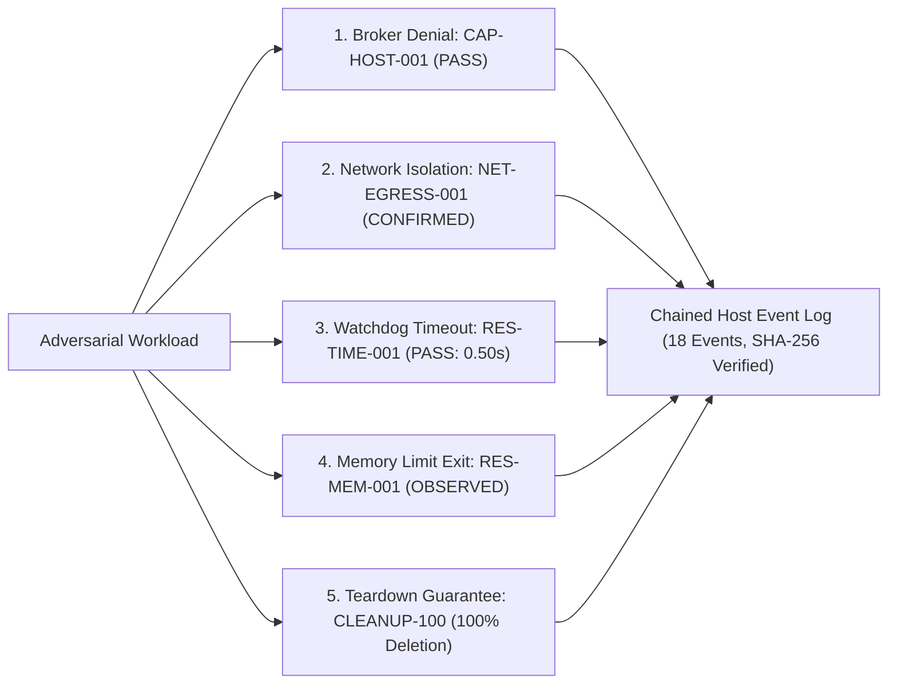
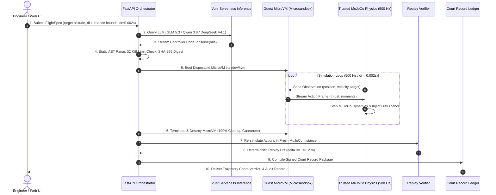
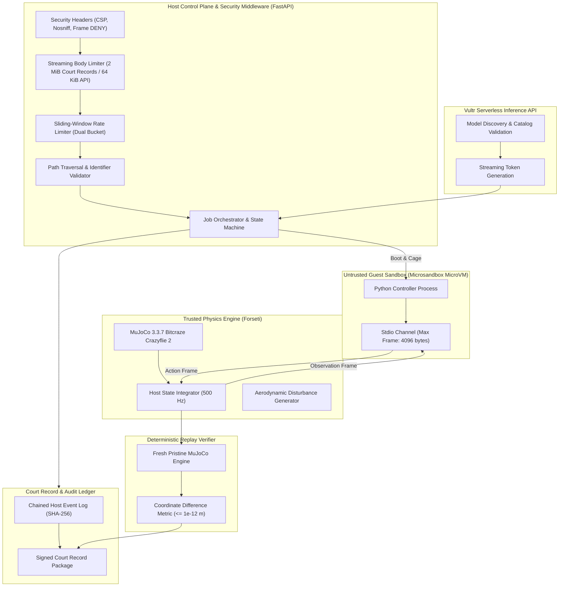
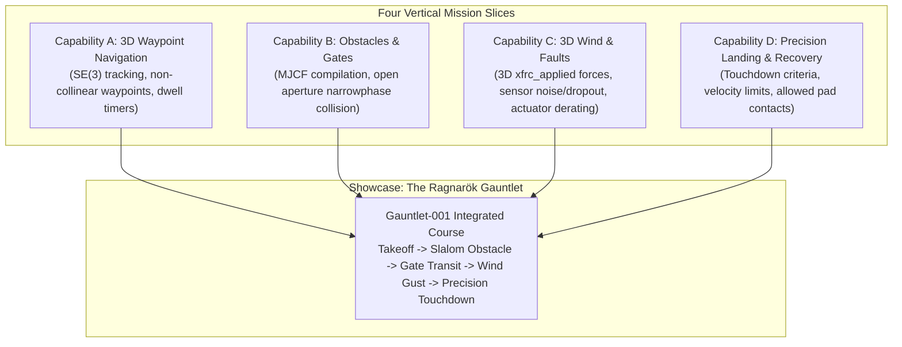
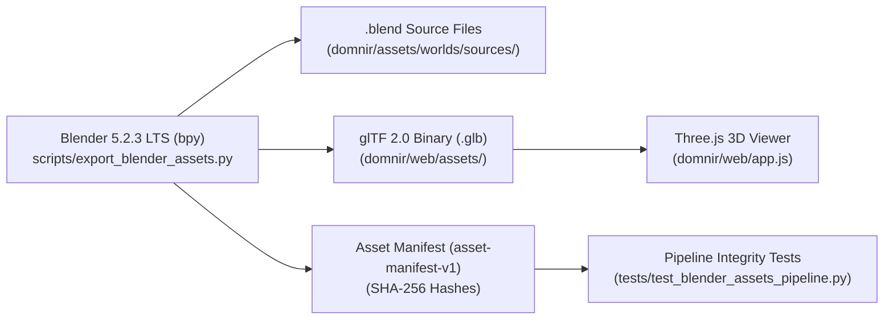

# Dómnir

**Adversarial Falsification and Containment Platform for AI-Generated Crazyflie 2 Flight Controllers**

*Built for Vultr Agent Rush Hackathon | Challenge 1: Blast Radius Zero*

[](LICENSE)
[](pyproject.toml)
[](https://github.com/google-deepmind/mujoco)
[](https://www.vultr.com/)
[](tests/)

---

### Quick Links
- **Hackathon Submission Report**: [docs/HACKATHON_SUBMISSION_REPORT.md](docs/HACKATHON_SUBMISSION_REPORT.md)
- **Four-Mission Contract ADR**: [docs/ADR/ADR-002-four-missions.md](docs/ADR/ADR-002-four-missions.md)
- **Live Edge Observatory (HTTPS)**: [https://domnir.erebuzzz.tech](https://domnir.erebuzzz.tech)
- **Live Direct Origin**: [http://45.76.48.77:8000/](http://45.76.48.77:8000/) (or [http://45.76.48.77/](http://45.76.48.77/))
- **Live Readiness API**: [https://domnir.erebuzzz.tech/ready](https://domnir.erebuzzz.tech/ready)
- **Containment Audit API**: [https://domnir.erebuzzz.tech/containment/status](https://domnir.erebuzzz.tech/containment/status)
- **Ragnarok Benchmark Report**: [docs/evidence/ragnarok_benchmark_report.json](docs/evidence/ragnarok_benchmark_report.json)
- **Challenge**: Vultr Agent Rush Hackathon | Challenge 1: Blast Radius Zero
- **License**: MIT License (MIT-compliant)

---

## Table of Contents
- [Part I: Hackathon Showcase (Vultr Agent Rush)](#part-i-hackathon-showcase-vultr-agent-rush)
  - [1. Challenge Overview & Blast Radius Zero Mission](#1-challenge-overview--blast-radius-zero-mission)
  - [2. How Vultr Powers Dómnir](#2-how-vultr-powers-dómnir)
  - [3. Multi-Model Selection Guide](#3-multi-model-selection-guide)
  - [4. Challenge 1 Containment Moments (Demo Guide)](#4-challenge-1-containment-moments-demo-guide)
  - [5. Autonomous Agent Workflow: Real Tasks](#5-autonomous-agent-workflow-real-tasks)
- [Part II: Platform Engineering & Technical Reference](#part-ii-platform-engineering--technical-reference)
  - [6. System Architecture & Trust Boundaries](#6-system-architecture--trust-boundaries)
  - [7. Physical Simulation & Deterministic Replay Engine](#7-physical-simulation--deterministic-replay-engine)
  - [8. Four-Mission Laboratory: 3D Flight & World Forge](#8-four-mission-laboratory-3d-flight--world-forge)
  - [9. Blender 5.2 Visual Asset Pipeline & Digital Twin](#9-blender-52-visual-asset-pipeline--digital-twin)
  - [10. Cryptographic Court Records](#10-cryptographic-court-records)
  - [11. REST API Reference](#11-rest-api-reference)
  - [12. Setup and Verification Guide](#12-setup-and-verification-guide)
  - [13. Production Deployment on Vultr Cloud Compute](#13-production-deployment-on-vultr-cloud-compute)
  - [14. Truthful Disclosures & Physical Limitations](#14-truthful-disclosures--physical-limitations)
  - [15. License, Security, and Privacy](#15-license-security-and-privacy)

---

# Part I: Hackathon Showcase (Vultr Agent Rush)

## 1. Challenge Overview & Blast Radius Zero Mission

Autonomous AI agents capable of writing code are rapidly expanding into physical systems, including robotics, drones, and industrial control. However, generating flight software introduces critical hazards:

1. **Physical Crash Risks**: Standard unit tests cannot evaluate whether an AI-generated control law stabilizes aerodynamic rotor physics or destabilizes into catastrophic ground crashes.
2. **Infrastructure Takeover Risks**: Executing untrusted AI code directly on host servers risks remote code execution, secret exfiltration, denial of service, and host network traversal.

Dómnir establishes a **Blast Radius Zero** architecture for AI-generated Crazyflie 2 flight controllers:
- **Zero Host Execution**: AI-generated code runs exclusively inside disposable, hardware-isolated microVMs with strict resource and network boundaries.
- **Trusted Host Physics**: The host physics harness owns MuJoCo, computes state transitions, clamps actuator bounds, and records truth telemetry.
- **Deterministic Replay Verification**: Independent re-simulation without controller code verifies reproducibility to within $10^{-12}$ m.
- **Cryptographic Court Records**: Immutable audit packages with SHA-256 asset digests and chained host event logs.

---

## 2. How Vultr Powers Dómnir

Dómnir runs entirely on Vultr Cloud infrastructure, leveraging both compute virtualization and serverless inference:

### 2.1 Vultr Cloud Compute (High Frequency with Nested KVM)
- **Compute Instance**: Vultr Cloud Compute High Frequency (`vx1-g-2c-8g-120s`, Tokyo region `nrt`).
- **Hardware Virtualization**: AMD EPYC processors with nested virtualization (`svm`) providing direct `/dev/kvm` hardware acceleration to the unprivileged `domnir` service user.
- **Sub-Second MicroVM Sandboxing**: Powers high-density, sub-second boot times for guest microVMs via Microsandbox (`msb 0.7.13`), guaranteeing complete kernel and memory boundary isolation from the host.
- **Hardened Deployment**: The control plane, trusted MuJoCo physics engine, and public web interface run directly as a systemd service (`domnir.service`) bound to public ports 80 and 8000.

### 2.2 Vultr Serverless Inference
- **Inference Gateway**: Dedicated Vultr Serverless Inference API at `https://api.vultrinference.com/v1`.
- **Zero Idle Costs**: On-demand token streaming eliminates expensive idle GPU server charges.
- **Low-Latency Synthesis**: Generates validated Python controller algorithms in 1.8 to 2.4 seconds with minimal reasoning overhead.
- **Server-Side Secret Isolation**: Inference credentials remain strictly backend-only in `.env` and are never exposed to the web browser or untrusted microVM guests.
- **Dynamic Catalog Validation**: Validates model availability against Vultr model endpoints (`GET /v1/models`) and enforces model match integrity.

---

## 3. Multi-Model Selection Guide

Dómnir exposes three distinct Vultr-hosted model families. Users can toggle between them directly in the web UI cards or via the REST API:

| Model ID | Provider | Latency | Specialization | Recommended Use Case |
| :--- | :--- | :--- | :--- | :--- |
| **`glm-5.3-flash`** (Default) | Vultr Serverless Inference | ~2.1 s | Schema adherence & rapid code generation | Standard hover missions, step response evaluation, rapid sweeps |
| **`qwen3.8-flash-next`** | Vultr Serverless Inference | ~2.4 s | Mathematical and state reasoning | Turbulent flight envelopes, disturbance recovery, non-linear targets |
| **`deepseek-v4.1-flash-1017`** | Vultr Serverless Inference | ~1.8 s | Compact logic & tight variable scoping | Highly constrained step budgets, deterministic PD gain tuning |

**Configurable Reasoning Effort**: Each model supports selectable reasoning effort levels (`minimal`, `low`, `medium`, and `high`) configurable directly in the web UI or via the `/controllers/generate` API payload, allowing users to tune between instant code emission and deep mathematical derivation.

Every model response is sanitized, checked for fenced Markdown blocks, parsed via Python AST, fingerprinted with SHA-256, and validated against the 32 KiB code limit before entering the microVM cage.

---

## 4. Challenge 1 Containment Moments (Demo Guide)

For the Vultr Agent Rush Challenge 1 submission, Dómnir demonstrates three clear containment moments:

### Containment Moment 1: Host Privilege & Capability Denial (`CAP-HOST-001`)
- **What Happens**: An untrusted controller attempts to probe host system files or call host canaries (`read_host_canary`).
- **Containment Action**: The host capability broker intercepts the request, verifies policy, responds with a strict `DENIED` status, and logs the attempt into the SHA-256 hashed host event log.
- **Outcome**: `PASS`. The guest remains strictly contained and cannot read host files or environment secrets.

### Containment Moment 2: Wall-Clock Execution Watchdog (`RES-TIME-001`)
- **What Happens**: An adversarial or buggy controller executes a CPU-locking infinite loop (`while True: pass`).
- **Containment Action**: The trusted host watchdog monitors monotonic wall-clock elapsed time. At exactly 0.50 s, the host forcibly terminates the guest microVM and reclaims memory and CPU.
- **Outcome**: `PASS`. The experiment transitions to `FAILED` without host freeze or resource starvation.

### Containment Moment 3: Default-Deny Network Isolation (`NET-EGRESS-001`)
- **What Happens**: An adversarial controller attempts external network communication (socket connect or data exfiltration).
- **Containment Action**: The virtual network interface enforces default-deny ingress and egress with zero published ports and zero host mounts.
- **Outcome**: `POLICY_CONFIRMED`. Socket connections fail immediately with `connection_failed`.

### The Five Containment Pillars



| Fixture ID | Category | Status | Evidence Source | Verification Outcome |
| :--- | :--- | :--- | :--- | :--- |
| **CAP-HOST-001** | Broker Capability Denial | **PASS** | `trusted_host_broker` | Host broker denies unauthorized capability request (`read_host_canary`). Guest receives strict `DENIED`. |
| **NET-EGRESS-001** | Network Isolation | **POLICY_CONFIRMED** | `trusted_runtime_configuration` | Host confirms default-deny egress/ingress, 0 published ports, 0 host mounts. Guest TCP connect fails. |
| **RES-TIME-001** | Resource Watchdog Timeout | **PASS** | `trusted_host_watchdog` | Guest running an infinite loop is terminated when monotonic wall-clock watchdog limit (0.50 s) is reached. |
| **RES-MEM-001** | Memory & Runtime Exit | **OBSERVED_EXIT_CAUSE_UNKNOWN** | `trusted_runtime_metrics_and_job_status` | Guest allocates 1 GiB under a 512 MiB limit. Exited with code -1. Truthfully reported without unsupported OOM claims. |
| **CLEANUP-100** | MicroVM Teardown Guarantee | **PASS** | `msb list` | 100% microVM deletion confirmed on all normal, timeout, crash, and abort paths. Zero leaked processes. |

---

## 5. Autonomous Agent Workflow: Real Tasks

Dómnir automates the real-world engineering workflow of evaluating AI control software for physical aerial robotics:



---

# Part II: Platform Engineering & Technical Reference

## 6. System Architecture & Trust Boundaries

The system enforces strict unidirectional trust boundaries between untrusted AI controllers and host infrastructure:



### Trust Boundary Rules
- **No guest secrets**: Guest microVMs receive no environment secrets, Vultr API keys, database credentials, host mounts, or Docker sockets.
- **Default-deny network**: Zero published ports, zero guest host mounts, and default-deny ingress and egress rules.
- **Host ownership**: The guest never touches MuJoCo model bytes or `MjData`.
- **Ephemeral lifetime**: Every microVM has a strict wall-clock timeout (0.50 s watchdog) and mandatory cleanup via context managers.

---

## 7. Physical Simulation & Deterministic Replay Engine

Dómnir utilizes MuJoCo 3.3.7 and the official Google DeepMind MuJoCo Menagerie Bitcraze Crazyflie 2 model:

- **Simulation Step**: $dt = 0.002$ s (500 Hz control loop).
- **Control Vector**: Clamped thrust $[0.0, 0.35]$ N and angular moments $[M_x, M_y, M_z]$.
- **Disturbance Modeling**: Injects aerodynamic disturbance forces ($F_z \in [-0.05, +0.05]$ N) to evaluate robustness.
- **Deterministic Replay**: Recorded actions are re-simulated in a brand-new MuJoCo model without executing controller code. Position and velocity coordinates must match recorded trajectory points within machine precision:
  $$\max_{k} \|\mathbf{qpos}_k - \mathbf{qpos}_k^{\text{replay}}\| \le 10^{-12} \text{ m}$$

---

## 8. Four-Mission Laboratory: 3D Flight & World Forge

To evaluate quadrotor flight beyond simple 1D vertical hover, Dómnir incorporates a full 6DOF mission execution laboratory governed by [docs/ADR/ADR-002-four-missions.md](docs/ADR/ADR-002-four-missions.md).



### 8.1 Capability A: 3D Waypoint Navigation (`domnir/missions/`)
- Multi-stage mission planner supporting `takeoff`, `waypoint`, `loiter`, and `landing` stages.
- Target position, velocity, tolerance spheres ($r \le 0.08$ m), and dwell time validation ($t_{dwell} \ge 0.10$ s).
- Reference SE(3) cascaded position and attitude controller ([`domnir/controls/baseline_3d.py`](domnir/controls/baseline_3d.py)) with tuned Crazyflie angular damping parameters.

### 8.2 Capability B: Physical Obstacles and Transit Gates (`domnir/worlds/`)
- Declarative `WorldSpec` schema supporting walls, pillars, landing pads, and transit gates.
- Transit gates compile into 4 separate boundary box geoms in MuJoCo MJCF, keeping the central 0.45 x 0.45 m aperture completely open for collision-free drone transit.
- Obstacle contact classifier tracks contact pairs and distinguishes unpermitted obstacle collisions from permitted floor or pad touchdowns.

### 8.3 Capability C: Admissible 3D Environmental Wind & Fault Injections (`domnir/faults/`)
- Continuous 3D aerodynamic forces injected directly into MuJoCo `data.xfrc_applied`.
- Guest-side sensor fault injection: additive Gaussian noise, drift bias, packet latency delay queues, and sensor dropouts.
- Actuator fault injection: motor derating factors ($[0.0, 1.0]$) and maximum thrust clipping.

### 8.4 Capability D: Precision Landing & Emergency Recovery (`domnir/safety/`)
- Touchdown monitoring evaluates position offset from pad center, vertical impact velocity ($|v_z| \le 0.35$ m/s), horizontal drift ($|v_{xy}| \le 0.20$ m/s), and tilt angle ($\theta \le 15^\circ$).
- Distinguishes `COMPLETED` mission status from physical safety status (`NOT_FALSIFIED`, `FALSIFIED`, `INVALID`).

### 8.5 Showcase: The Ragnarök Gauntlet
- An integrated flight course combining all four capabilities in one continuous evaluation:
  1. Takeoff from origin to $z = 0.40$ m.
  2. Navigate around a 0.80 m slalom pillar obstacle.
  3. Transit cleanly through the 0.45 x 0.45 m cyan gate at $z = 0.45$ m.
  4. Withstand an admissible lateral wind gust ($F_y = 0.015$ N).
  5. Execute controlled descent to a precision touchdown on the landing pad at $(1.10, 0.0, 0.03)$ m.
- **Current status:** with stage deadlines enforced, the built-in baseline completes takeoff but misses the slalom deadline (1.80 s), so the default Gauntlet returns `mission_verdict=NOT_COMPLETED` (1/5 stages). The physical verdict is still `NOT_FALSIFIED`. The deadlines have not yet been recalibrated against an achievable baseline flight profile.

---

## 9. Blender 5.2 Visual Asset Pipeline & Digital Twin

Dómnir incorporates an automated asset authoring pipeline bridging physical simulation and visual rendering:



### 9.1 Asset Inventory & Hash Manifest
All visual assets are tracked with SHA-256 checksums in [`domnir/assets/worlds/manifests/manifest.json`](domnir/assets/worlds/manifests/manifest.json):

| Asset Name | Blender Source (`.blend`) | glTF Binary (`.glb`) | Coordinate Frame | Dimensions / Details |
|---|---|---|---|---|
| **Gate 01** | `gate_01.blend` (89.5 KB) | `gate_01.glb` (5.3 KB) | `world-z-up-right-handed` | Cyan PBR, 4 perimeter posts, 0.45x0.45 m hollow aperture |
| **Landing Pad** | `landing_pad.blend` (92.8 KB) | `landing_pad.glb` (8.3 KB) | `world-z-up-right-handed` | Emerald PBR, 0.35x0.35 m base, bullseye target ring |
| **Obstacle Pillar** | `obstacle_pillar.blend` (92.0 KB) | `obstacle_pillar.glb` (13.7 KB) | `world-z-up-right-handed` | Amber hazard PBR, r = 0.06 m, h = 0.80 m cylinder |
| **Arena Assets** | `arena_assets.blend` (99.3 KB) | N/A | `world-z-up-right-handed` | Master Blender scene containing all world collections |
| **Crazyflie 2** | `crazyflie_2.blend` (270.4 KB) | `crazyflie_2.glb` (437.1 KB) | `world-z-up-right-handed` | Bitcraze quadrotor with animated rotors (`RotorFL/FR/RL/RR`) |

### 9.2 WebGL Three.js Rendering
- Loaded via `THREE.GLTFLoader` with procedural mesh fallbacks if network loading fails.
- Synchronized rotor spin animations responding to simulation telemetry.
- Dynamic world object rendering for static obstacles, transit gates, and touchdown pads.

---

## 10. Cryptographic Court Records

Every experiment outputs a verifiable Court Record (`domnir-court-record-v1`):

```json
{
  "schema_version": "domnir-court-record-v1",
  "record_id": "cr-eef6eff83e5246f5",
  "experiment_id": "86747975-c1db-48b9-a2a8-db2b5a6aeaf4",
  "verdict": "NOT_FALSIFIED",
  "verdict_reason": "All scenario safety constraints satisfied within tolerances.",
  "controller": {
    "source_code": "def observe(obs): ...",
    "source_sha256": "31aac2db...",
    "model_id": "glm-5.3-flash"
  },
  "replay": {
    "verdict": "MATCHED",
    "max_abs_difference": 0.0,
    "tolerance": 1e-12
  },
  "host_event_log": {
    "event_count": 18,
    "sha256_head": "48148340...",
    "verified": true
  }
}
```

- **Tamper Resistance**: Modifying any coordinate or action invalidates the SHA-256 digest.
- **In-Browser Verification**: The web UI includes an interactive drag-and-drop Court Record Verifier enabling third parties to independently verify trial integrity.

---

## 11. REST API Reference

The FastAPI service exposes structured, type-safe REST endpoints with Pydantic schema validation, sliding-window rate limiting, request size enforcement, and security headers:

### Health and Readiness
- `GET /health`: Returns service health, version, and server timestamp.
- `GET /ready`: Returns readiness status, loaded model status, Vultr inference status, and microVM availability.
- `GET /models`: Lists configured Vultr Serverless Inference models with metadata and default selection.

### Flight Specs and Code Generation
- `POST /specs/validate`: Validates flight envelope bounds (`target_altitude_m`, `mission_duration_s`, `dt_s`, step budget).
- `POST /controllers/generate`: Queries Vultr Serverless Inference to generate a validated Python controller function `observe(obs)`.

### Qualification Experiments
- `POST /experiments/run`: Submits an experiment for execution. Accepts specification, model, disturbance force, and controller source (maximum 32 KiB). Supports synchronous or asynchronous background execution.
- `GET /experiments/{experiment_id}`: Retrieves experiment state, history, metrics, and verdict.
- `GET /experiments/{experiment_id}/artifacts`: Retrieves complete simulation trajectory vectors, event logs, and Court Record.
- `GET /experiments/{experiment_id}/court-record`: Exports standalone Court Record JSON package.

### Four-Mission Laboratory & Worlds
- `GET /worlds`: Lists available physical worlds (`arena-gate-v1`, `gauntlet-v1`) with entity counts and asset IDs.
- `GET /worlds/{id}`: Retrieves detailed world configuration, colliders, aperture geometry, and asset manifest hashes.
- `POST /missions/run`: Executes full 6DOF mission simulation across waypoints, obstacles, wind disturbances, and landing targets.
  - **Stage deadlines are enforced.** A stage is `COMPLETED` only if it is reached (and dwelled) at or before its `completion_deadline_s`; otherwise it is `TIMED_OUT`, and stages never attempted are `ABORTED`. `stage_timeout_policy` is `abort` (default: later stages are aborted) or `advance` (move on and judge each later stage on its own deadline). `mission_verdict` is `COMPLETED` only when every stage completed on time.
  - **Limits:** at most 12 stages (each deadline ≤ 60 s), 16 faults of each kind, 90 s of wall time per run, 2 concurrent runs and 4 waiting. Over-limit requests get 422. A full queue gets 503 with `Retry-After`. A run over its wall-time budget gets 504.
  - **Evidence fields:** `stages_completed`/`total_stages`, `isolation_status` (`NOT_APPLICABLE` for the built-in baseline, `MICROVM`, or `UNISOLATED` for the dev fallback), `cleanup_status` (teardown observed for this run), and `provenance_status` (`BUILT_IN_BASELINE`, or `UNVERIFIED_ORIGIN` for any submitted source, whose `model_id` is client-reported). Sandbox setup or guest failures return 502 with the observed cleanup status rather than a physical verdict.

### Verification and Containment
- `POST /court-records/verify`: Independent in-memory physical replay verifier. Replays recorded actions on a fresh MuJoCo instance, verifies SHA-256 hashes, and checks event log chaining.
- `GET /containment/status`: Returns verified results for the 5 containment fixtures, host event log status, and limitations.
- `POST /containment/run`: Triggers a live run of the microVM containment suite on KVM-enabled Linux hosts.

---

## 12. Setup and Verification Guide

### Prerequisites
- Python 3.12 (`>=3.12,<3.13`)
- `uv` package manager
- Git
- Optional: Blender 5.2.3 LTS for source `.blend` re-authoring

### 1. Local Development Setup

```bash
# Clone the repository
git clone https://github.com/Erebuzzz/domnir.git
cd domnir

# Install pinned dependencies
uv sync --locked

# Clone the Bitcraze Crazyflie 2 model from MuJoCo Menagerie
git clone --filter=blob:none --no-checkout https://github.com/google-deepmind/mujoco_menagerie.git .cache/mujoco_menagerie
git -C .cache/mujoco_menagerie sparse-checkout set bitcraze_crazyflie_2
git -C .cache/mujoco_menagerie checkout 98a70c569c4c1b6da467a20012f766ee1f8dc521

# Configure environment variables (set Vultr Inference API key)
echo "VULTR_INFERENCE_API_KEY=your_key_here" > .env
```

### 2. Run the Full Test Suite

```bash
# Run all unit, integration, mission, and asset pipeline tests
uv run pytest -v
```

All 257 tests run deterministically:
- On non-KVM hosts: microVM-specific integration tests cleanly skip while all simulation, inference, API, replay, security, contracts, mission waypoints, obstacles, faults, precision landing, Ragnarök gauntlet, and Blender asset pipeline tests pass (257 passed, 11 skipped, 34 subtests passed, 0 failed).
- On live KVM-enabled Vultr hosts: all tests pass.

### 3. Launch the Web Application

```bash
uv run uvicorn domnir.api.app:app --host 127.0.0.1 --port 8000 --reload
```

Open `http://localhost:8000` in any modern web browser to access the Dómnir platform:

- **Four-Mission Arena & Gauntlet**: 3D interactive waypoint, obstacle gate, and landing pad simulation with telemetry playback.
- **Rune Dawn and Rune Dusk Theme System**: Mode-aware UI aesthetic featuring warm sandstone and burnt copper in Rune Dawn, and midnight obsidian with Bifrost cyan in Rune Dusk. Both modes incorporate 4-tier elevation shadow tokens and WCAG AA contrast.
- **Authentic 3D Drone Digital Twin**: WebGL Three.js interactive physical plant viewer derived from MuJoCo Menagerie CAD meshes via Blender 5.2.3 LTS. Features turntable rotation, orbital camera controls, concentric rotor spin axes, and high-resolution Cycles PBR stills for zero-latency fallback.
- **Synchronized Simulation Replay**: Dual-view playback synchronizing the 2D altitude SVG trajectory with the 3D quadrotor spatial orientation, complete with interactive scrubber and timestep hover inspection.
- **Ragnarok Knowledge Oracle**: Grounded technical retrieval engine citing platform architecture and containment proofs, accessible via both the Docs tab and a collapsible Workspace quick drawer.
- **Court Record Verifier**: In-browser drag-and-drop verification of signed Court Record packages against an independent pristine MuJoCo engine.
- **Containment Audit Tab**: Live and certified microVM isolation proofs across all five containment pillars.
- **Trust Architecture**: Interactive security boundary documentation with clear non-negotiable trust rules.

---

## 13. Production Deployment on Vultr Cloud Compute

For production deployment on a Vultr Cloud Compute instance running Ubuntu 24.04 LTS:

### 1. Host Virtualization Verification
```bash
# Confirm KVM hardware virtualization
ls -l /dev/kvm
egrep -c '(vmx|svm)' /proc/cpuinfo

# Grant permissions to deployment user
sudo usermod -aG kvm domnir
```

### 2. Systemd Service Installation
Dómnir includes a pre-configured systemd service definition in `domnir.service`:

```bash
# Copy systemd unit file
sudo cp domnir.service /etc/systemd/system/domnir.service

# Reload systemd and enable service
sudo systemctl daemon-reload
sudo systemctl enable domnir
sudo systemctl start domnir

# Check service status and logs
sudo systemctl status domnir
journalctl -u domnir -f
```

### 3. Cloudflare Edge Reverse Proxy with Custom Domain
To provide edge TLS termination, HTTP/2 and HTTP/3 support, DDoS mitigation, and global custom domain routing (`https://domnir.erebuzzz.tech`) to the Vultr Cloud Compute instance, Dómnir includes a lightweight edge reverse proxy in `deploy/cloudflare/`:

```bash
cd deploy/cloudflare
npx wrangler deploy
```

The worker terminates TLS at Cloudflare edge locations, forwards requests to the live Vultr compute instance origin, preserves full streaming request/response bodies, and injects origin observability headers.

---

## 14. Truthful Disclosures & Physical Limitations

In accordance with the Blast Radius Zero engineering guidelines, Dómnir maintains absolute transparency regarding physical modeling assumptions:

1. **Uncalibrated Menagerie Limits**: The Google DeepMind MuJoCo Menagerie Crazyflie 2 model actuator limits are uncalibrated and untuned. They reflect nominal aerodynamic approximations, not real hardware rotor dynamics.
2. **Software Falsification vs. Airworthiness**: A successful simulation trial or qualification sweep demonstrates only that a controller did not violate bounds within the synthetic scenario. It is never a certificate of real-world flight safety.
3. **No Fake Passes**: When evidence is incomplete or metrics cannot be attributed, Dómnir strictly emits `INCONCLUSIVE`, `PARTIAL`, or `OBSERVED_EXIT_CAUSE_UNKNOWN`, never invented `PASS` or `SAFE` statuses.

---

## 15. License, Security, and Privacy

- **License**: Licensed under the [MIT License](LICENSE) (MIT-compliant open source license).
- **Security Policy**: See [SECURITY.md](SECURITY.md) for vulnerability reporting and containment threat models.
- **Privacy Policy**: See [PRIVACY.md](PRIVACY.md) for our zero-telemetry, ephemeral sandbox privacy principles.
