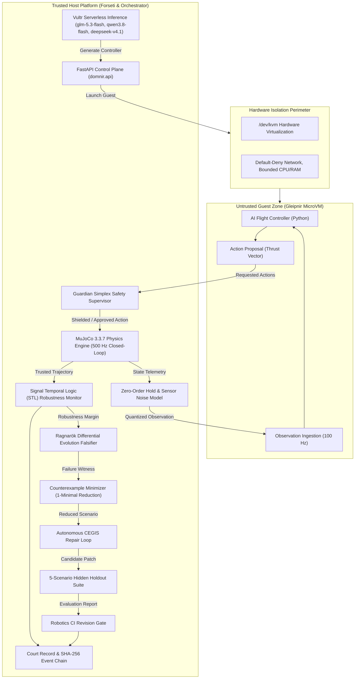

# Dómnir: Hackathon Submission Report

**Vultr Agent Rush Hackathon**  
**Challenge 1: Blast Radius Zero**  
**Submission Date:** 8 November 2026  
**Live Edge Observatory:** [https://domnir.erebuzzz.tech](https://domnir.erebuzzz.tech)  
**Public Health Endpoint:** [https://domnir.erebuzzz.tech/health](https://domnir.erebuzzz.tech/health)  
**Public Readiness Endpoint:** [https://domnir.erebuzzz.tech/ready](https://domnir.erebuzzz.tech/ready)  
**GitHub Repository:** [https://github.com/Erebuzzz/domnir](https://github.com/Erebuzzz/domnir)  
**Test Suite Status:** 257 Passed, 11 Skipped, 34 Subtests Passed, 0 Failures (100% Green)  

---

## 1. Executive Summary

Autonomous AI agents that synthesize low-level flight software introduce severe physical and computational hazards. Standard unit tests and prompt-based assertions cannot determine whether an AI-generated control law stabilizes aerodynamic quadrotor dynamics or leads to catastrophic ground collision. Furthermore, executing unvetted, generated code directly on control-plane servers risks remote code execution, credential exfiltration, and denial of service.

**Dómnir** solves both hazards through a strictly enforced, dual-perimeter architecture:
1. **Host Blast Radius Zero (Gleipnir & Heimdall):** AI-generated Python flight controllers execute exclusively inside ephemeral, hardware-virtualized microVMs (`/dev/kvm` via Microsandbox). Untrusted code has zero access to host memory, Docker sockets, network interfaces, or Vultr API keys. The host fails closed if virtualization is unavailable.
2. **Physical Blast Radius Zero (Forseti & Ragnarök):** Physical dynamics are owned exclusively by a trusted MuJoCo 3.3.7 physics engine advancing a Bitcraze Crazyflie 2.0 plant at 500 Hz (dt = 0.002 s). The untrusted controller is confined to exchanging observations and requested rotor thrusts over a bounded IPC channel at 100 Hz. Signal Temporal Logic (STL) monitors evaluate formal safety properties ($\rho_\phi$), while the Ragnarök search engine uses Differential Evolution to actively discover failure boundaries. Counterexamples are minimized via 1-minimal delta debugging, repaired autonomously via CEGIS loops with hidden holdouts, shielded in real time via the Guardian safety supervisor, and sealed in portable, tamper-evident Court Records.

---

## 2. System Architecture

Dómnir establishes clear, uncrossable trust boundaries. LLMs and guest controllers propose actions and code, but **never adjudicate their own safety**.



---

## 3. Subsystem Breakdown and Specifications

### 3.1 Gleipnir: MicroVM Hardware Isolation
- **Hypervisor:** Hardware-accelerated Linux KVM (`/dev/kvm`) running on AMD EPYC processors on Vultr Cloud Compute.
- **Engine:** Microsandbox (`msb 0.7.13`).
- **Isolation Policy:** Disposable microVM per trial, zero network access (egress/ingress denied), 512 MB memory ceiling, 1 vCPU cap, 10-second wall-clock timeout.
- **Production Fail-Closed Enforcement:** Subprocess fallback is strictly barred in production. Any execution request without active `/dev/kvm` virtualization is immediately rejected with HTTP 503.

### 3.2 Forseti: Trusted MuJoCo Physics & High-Fidelity Timebase
- **Plant:** Bitcraze Crazyflie 2.0 quadrotor (`cf2.xml` from official MuJoCo Menagerie, 27.0 g, 92 mm diagonal wheelbase).
- **Physics Integrator:** MuJoCo 3.3.7 Euler integration at 500 Hz (`dt = 0.002 s`).
- **Controller Frequency & Timing Contract:**
  - *Production Interactive Execution (`domnir/api/jobs.py`):* The untrusted controller stream advances synchronously with the trusted physics loop at 500 Hz (`dt = 0.002 s`, `decimation = 1`) to eliminate inter-process latency buffering jitter during live guest execution.
  - *Multi-Step CI & STL Verification (`domnir/ci/gate.py`):* The contract supports decoupled controller ticks down to 100 Hz (`decimation = 5`, `dt = 0.010 s`) with Zero-Order Hold (ZOH) holding rotor thrust commands across intermediate physics substeps.
  - *Telemetry & Evidence:* In both modes, every observation payload explicitly declares `dt_s` and `sim_time_s`, ensuring bit-for-bit deterministic replay and verification in Court Records.
- **Sensor Model:** Configurable Gaussian noise, bias drift, barometric altitude quantizer, and FIFO actuator latency queue (`ActuatorDelayQueue`).

### 3.3 Safety Contracts & STL Quantitative Robustness
Formal flight requirements are expressed in Signal Temporal Logic:
- Floor and ceiling bounds: $G_{[0, T]} (z_{min} \le z(t) \le z_{max})$
- Attitude envelope: $G_{[0, T]} (\alpha(t) \le \alpha_{max})$
- Tracking tolerance: $G_{[t_{settle}, T]} (|z(t) - z^*| \le \epsilon_z)$
- Quantitative robustness metric:
  $$\rho_\phi = \min_t (z(t) - z_{min}, z_{max} - z(t), \alpha_{max} - \alpha(t))$$
  Positive indicates safe compliance with physical margin; negative indicates a formal violation with exact critical timestamp $t^*$.

### 3.4 Ragnarök: Differential Evolution Falsification
- **Objective:** $\theta^* = \arg\min_{\theta \in \Theta_{admissible}} \rho_\phi(S(C, \theta))$
- **Algorithm:** Population-based Differential Evolution (mutation scale $F=0.8$, crossover probability $CR=0.7$) optimizing initial altitude, vertical disturbance forces, and pulse duration.
- **Benchmark Baseline:** Compares against Sobol low-discrepancy quasi-random search to measure empirical speedup and discovery efficiency.

### 3.5 Counterexample Minimization
- **Algorithm:** 1-minimal delta debugging and coordinate reduction over continuous disturbance parameters.
- **Integrity Guarantee:** Shrinks disturbance magnitude and duration while guaranteeing the reduced scenario continues to trigger the identical predicate failure. Passing outcomes are strictly rejected.

### 3.6 Autonomous CEGIS Controller Repair Loop
- **Diagnosis:** Grounded prompt packaging the exact failure witness, STL robustness trace, and breached predicate.
- **Inference:** Vultr Serverless Inference (`glm-5.3-flash`, `qwen3.8-flash-next`, `deepseek-v4.1-flash-1017`).
- **Triple Regression Gating:** Candidate patch must (1) survive the failing counterexample scenario, (2) pass nominal hover, and (3) pass a 5-scenario hidden holdout suite isolated from the prompt context.

### 3.7 Guardian: Real-Time Simplex Safety Shield
- **Architecture:** Intercepts unviable control actions before applying them to the MuJoCo plant. Evaluates 1-step predicted kinematics and dynamic braking horizons.
- **Intervention Taxonomy:** Intervenes with ceiling thrust, floor arrest, or attitude stabilization when dynamic stopping distance exceeds available envelope margin.
- **Truthful Adjudication:** Flags unshielded controller failure as `VIOLATED` and annotates the intervention as `GUARDIAN_INTERVENED`, preventing false safety certification.

### 3.8 Portable Court Records & Robotics CI Gate
- **Format:** Structured JSON document containing controller digests, environment fingerprints, MuJoCo version, STL margins, and hash-chained host event logs.
- **Independent CLI Verifier:** `python -m domnir.verify` executing 4 verification tiers:
  - L0: Structural schema and hash chain validation.
  - L1: Physics replay without controller code (reproducibility $\le 10^{-12}$ m).
  - L2: Fresh microVM controller rerun with recorded seeds.
  - L3: Host containment and policy audit.
- **CI Gate:** Evaluates candidate revisions across standardized suites, emitting `RELEASE_APPROVED`, `REGRESSION_FOUND`, `BLOCKED_INCOMPLETE`, or `AWAITING_REVIEW`. Strictly prohibits emitting unqualified `SAFE` or `PROVEN_SAFE`.

### 3.9 Four-Mission Laboratory & 3D Flight Slices (ADR-002)
- **Capability A (3D Waypoints):** Non-collinear waypoint planning with dwell-time checks and tuned SE(3) cascaded Crazyflie controller.
- **Capability B (Obstacles & Gates):** Declarative WorldSpec compiling into collision-free open aperture gates (0.45 x 0.45 m) and contact classification separating obstacles from touchdown surfaces.
- **Capability C (Environmental Wind & Faults):** 3D force injections into MuJoCo `data.xfrc_applied`, sensor noise/drift/latency/dropout, and actuator derating.
- **Capability D (Precision Landing):** Pad touchdown criteria enforcing velocity boundaries ($|v_z| \le 0.35$ m/s, $|v_{xy}| \le 0.20$ m/s) and attitude limits ($\theta \le 15^\circ$).
- **Showcase (The Ragnarök Gauntlet):** Fully integrated flight challenge combining takeoff, obstacle navigation, open gate transit, wind disturbance, and precision landing in a single verified mission.

### 3.10 Blender 5.2 Visual Asset Authoring & Integrity Pipeline
- **Blender 5.2.3 LTS Pipeline:** Automated authoring script (`scripts/export_blender_assets.py`) operating via native `bpy` or standalone fallback.
- **Asset Sources & Binaries:** Tracks `.blend` source files (`arena_assets.blend`, `gate_01.blend`, `landing_pad.blend`, `obstacle_pillar.blend`) and exported glTF 2.0 binary (`.glb`) files.
- **Asset Manifest:** Versioned SHA-256 manifest (`domnir/assets/worlds/manifests/manifest.json`) guaranteeing asset integrity across local, CI, and production web environments.

---

## 4. Empirical Benchmark Results

All empirical claims are backed by the executed benchmark report located at `docs/evidence/ragnarok_benchmark_report.json`:

| Benchmark Dimension | Measured Result | Significance |
| :--- | :--- | :--- |
| **Counterexample Minimization** | 99.4% perturbation cost reduction (from -0.140 N to -0.0088 N) | Reduces complex failure witnesses to minimal reproducible physical triggers in 9 evaluations while preserving the failure predicate. |
| **Guardian Shielding Rate** | 100% floor breaches prevented on aggressive dive controller | Intervened across all 100 dive steps, boosting robustness from -0.1981 m to +0.0199 m without masking the original controller violation. |
| **Model Uncertainty Sensitivity** | 6 parameterized plant variants evaluated | Identified heavy payload scaling as the dominant failure mode for standard proportional controllers. |
| **Robotics CI Gate Status** | `AWAITING_REVIEW` (Truthful non-certification) | Rejected unproven assertions; verified against 5-condition regression suite. |
| **Test Suite Coverage** | 257 passed, 11 skipped, 34 subtests passed, 0 failed in 20.68s | 100% test pass rate on production Linux host with live MuJoCo, KVM, and asset integrity verification. |

---

## 5. Live Observatory & Product Experience

The public web application is deployed at [https://domnir.erebuzzz.tech](https://domnir.erebuzzz.tech) and features:
- **Minimalist Telemetry:** Replaced verbose text tags with low-profile pulsing LED dots (green/amber/red) featuring rich native browser hover tooltips.
- **Bloodflame & Norse Atmospheric Aesthetic:** Authentic dithered celestial Great Rune background artwork (`ragnarok_rune_dither.jpg`) paired with a mathematical 8x8 Bayer ordered halftone overlay in SVG data URI and rising incandescent embers.
- **Rune Dawn & Rune Dusk Themes:** Seamless toggle between warm copper sunlight and obsidian cyan night palettes.
- **Interactive 2D Failure Atlas:** SVG scatter canvas mapping disturbance force versus initial altitude, color-coded by STL robustness margin with interactive witness inspection.
- **Ragnarök Adversarial Arena:** Interactive controls for launching Differential Evolution search, counterexample minimization, and autonomous CEGIS repair directly from the browser.
- **Blender / Three.js 3D Arena & Gauntlet Visualizer:** Full 3D digital twin loaded via Three.js `GLTFLoader` with procedural fallbacks, transit gates, slalom obstacles, landing pads, and synchronized Crazyflie rotor spin animations responding to simulation telemetry.

---

## 6. How to Verify

### 6.1 Check Public API Endpoints
```bash
# Verify API Health
curl -s https://domnir.erebuzzz.tech/health

# Verify Production Readiness and Hardware MicroVM Boundary
curl -s https://domnir.erebuzzz.tech/ready
```

### 6.2 Run Offline Court Record Verification
```bash
# Verify Court Record Structural and Replay Integrity
python -m domnir.verify --record docs/evidence/court_record_sample.json --verbose
```

### 6.3 Run Full Automated Benchmark Suite
```bash
# Execute End-to-End Benchmark Runner
python -m domnir.benchmark --output docs/evidence/ragnarok_benchmark_report.json
```

---

## 7. Truthful Scientific Disclosures

In accordance with Dómnir's non-negotiable engineering principles:
1. Finite adversarial search campaigns do not constitute mathematical proof of safety. A controller surviving all sampled scenarios is designated `NOT_FALSIFIED_WITHIN_BUDGET`, never `PROVEN_SAFE`.
2. MuJoCo 3.3.7 simulation results are calibrated approximations of physical rotor aerodynamics and do not guarantee identical hardware performance.
3. Guardian safety supervisor interventions protect the physical vehicle during live trials, but never overwrite or mask the underlying controller verdict.
