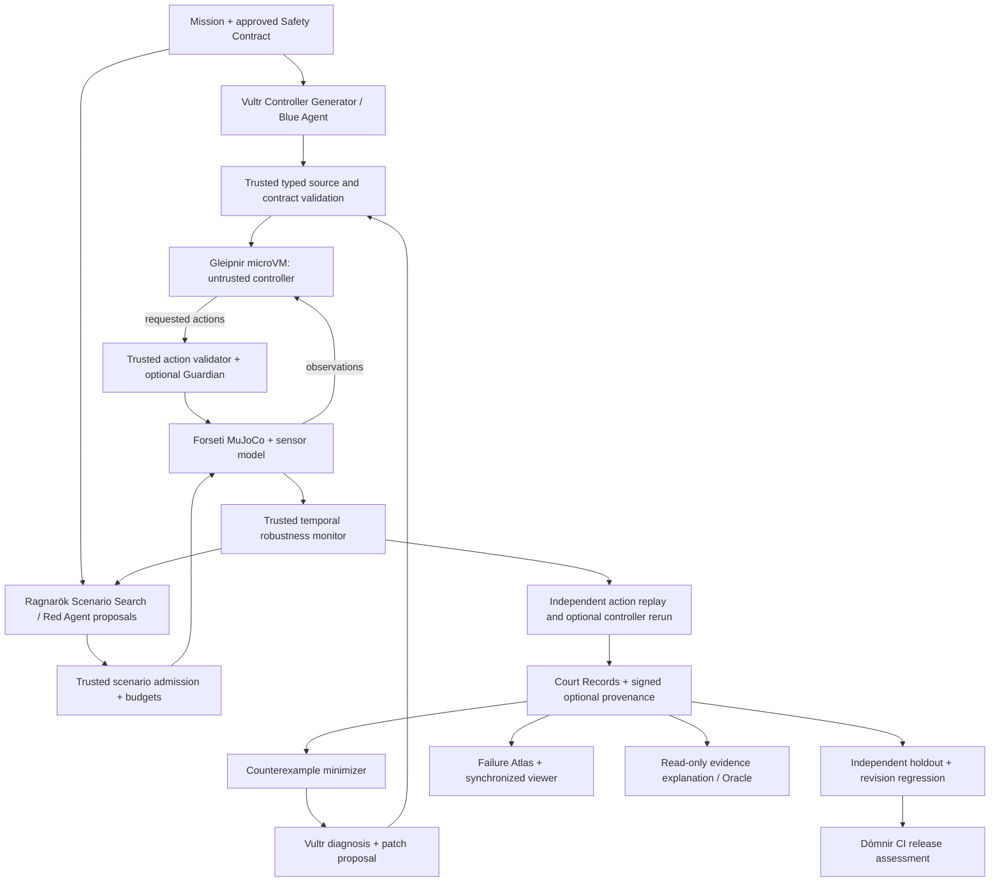

# DÓMNIR: Research-Grounded Upgrade Plan

**Document:** `Upgrade_Plan.md`  
**Version:** 1.0, 7 November 2026  
**Basis:** latest uploaded `domnir(2).zip`, existing `AGENTS.md`, implementation blueprint, and the engineering audits in this conversation.  
**Status:** Proposed architecture and acceptance criteria. **This document does not claim any of the upgrades have already been implemented, benchmarked, or deployed.**  
**Product direction:** An autonomous, adversarial, evidence-backed laboratory for robotic controller development: **specify → synthesize → isolate → simulate → falsify → minimize → diagnose → repair → challenge → adjudicate → release assessment**.

> **Primary engineering decision:** Implement all the capabilities in this plan as one coherent system, not as independent AI gimmicks. The trusted simulator and safety monitors decide physical outcomes. The microVM enforces the untrusted-code boundary. LLMs propose controllers, candidate adversarial strategies, and repairs but **never certify their own results**.
>
> **Scope:** Crazyflie 2 and the existing pinned MuJoCo plant are the reference implementation. Multi-robot support is an eventual adapter design, not permission to rewrite the working Crazyflie implementation. Keep Vultr Serverless Inference for model-driven workflows. No Gemini Robotics ER 2 or NVIDIA NIM in the hackathon path.

---

## 1. Executive decision and research thesis

Dómnir currently does something important but narrow: it generates or accepts a flight controller, runs it in a Microsandbox guest, advances a trusted MuJoCo model, compares physical behavior against basic flight constraints, replays recorded actions, and produces hash-linked evidence. The proposed **Ragnarök Engine** should turn that workflow into an iterative form of *counterexample-guided adversarial controller engineering*.

The defensible research question is:

> **Can a trusted, isolated, simulation-guided adversarial workflow find reproducible failures in AI-generated robot controllers more efficiently than baseline test generation, and can counterexample-guided revisions improve performance on both known failures and unseen conditions without masking containment or model uncertainty?**

This is **not** the claim that Dómnir invents falsification, counterexample-guided synthesis, shielded control, or digital provenance. Those have established research foundations. The novel engineering contribution to pursue is their integration into an auditable developer workflow for *untrusted, AI-generated physical-control code* [R01–R08, R13–R16].

### Intended product subsystems

| Subsystem | Function | Ownership |
|---|---|---|
| **Forseti / trusted evaluation** | MuJoCo state, action validation, temporal monitors, final physical findings | Trusted host |
| **Gleipnir / contained execution** | Runs generated controller code with explicit guest policy and bounds | MicroVM |
| **Heimdall / containment evidence** | Host-observed policy, denials, timeouts, resource limits, cleanup | Trusted host |
| **Ragnarök Search** | Finds difficult admissible physical scenarios | Trusted orchestrator; numerical optimizers |
| **Ragnarök Arena** | Red-team scenario proposals and blue-team controller revisions | Vultr LLM proposals; trusted approval/evaluation |
| **Counterexample Lab** | Minimizes and explains measured failures | Trusted search and monitor |
| **Guardian** | Research-only runtime safety supervisor, with intervention logging | Trusted simulator-side component |
| **Failure Atlas** | Explorable map of *tested* scenario outcomes | Derived, non-authoritative presentation |
| **Court Record / Portable Verifier** | Trace, source and environment provenance, replay, distinct evidence checks | Trusted recorder and independent verifier |
| **Dómnir CI** | Reusable benchmark suites and revision-level release assessments | Trusted orchestration |
| **Ragnarök Knowledge Oracle** | Grounded explanation, documentation search and contextual guidance | Read-only retrieval plus Vultr synthesis |

### Non-negotiable separation of concepts

1. **Simulation falsification is not a guarantee about real hardware.**
2. **Numerical re-simulation of saved actuator commands is not equivalent to rerunning a controller and obtaining the same decisions.** Track both separately.
3. **A guest running in a microVM is not automatically proof that every policy was enforced.** Require host observations.
4. **A SHA-256-linked JSON record is not inherently signed, independently anchored, immutable, or externally trusted.**
5. **A controller passing all sampled scenarios is `NOT_FALSIFIED_WITHIN_BUDGET`, never `PROVEN_SAFE`.**
6. **No time-based shortcuts:** Build every planned capability, but follow dependency gates and correctness criteria. Do not skip a gate merely to present a dramatic demonstration.

---

## 2. Grounded baseline and technical debt that must be resolved

These are **source-inspection findings**, not a claim that the entire live deployment was independently executed. File and line locations may shift after subsequent commits; confirm the current branch before editing.

### What is already implemented

- `domnir/spec.py`: `FlightSpec` and `GeneratedController`; source length, AST parse, `observe` function and digest checks.
- `domnir/inference/vultr.py`: Vultr inference client and controller-generation flow.
- `domnir/api/jobs.py`: job states, bounded queue/concurrency, guest stream, trusted MuJoCo run, event logging, record construction.
- `domnir/sandbox.py`, `domnir/protocol.py`, `domnir/fixture_trial.py`: sandbox lifecycle and validated observation/action exchange.
- `domnir/simulation.py`, `domnir/replay.py`: pinned physics, full-state capture and independent actuator replay.
- `domnir/campaign.py`: seeded and predefined scenarios and conservative record summaries, **not yet an adaptive optimizer**.
- `domnir/court_record.py`, `domnir/event_log.py`: structured Court Records and hash-linked host event logs.
- `domnir/web/*`, `domnir/assets/crazyflie_2.blend`: Rune Dawn/Dusk interface, documentation search, and Blender/Three.js presentation assets.

### Confirmed or previously observed issues to audit first

| ID | Current behavior or finding | Required correction and reason |
|---|---|---|
| B01 | Latest archived `domnir/web/app.js` failed `node --check` due to an unclosed block before `function resize()` | Repair the exact syntax defect, then run browser smoke tests; no other frontend work can be accepted without a parseable build. Recheck against newest revision. |
| B02 | Public execution has an opt-in development subprocess fallback in `domnir/api/jobs.py` | Ensure the public deployment cannot activate host execution of untrusted code. Separate trusted development harness and fail closed if isolation is unavailable. |
| B03 | Privileged containment endpoint access can depend on whether an operator token is configured | Missing operator credentials must disable privileged functions, not grant anonymous access. |
| B04 | Proxy-supplied client identity could be spoofed if `X-Forwarded-For` is trusted without an explicit trusted-proxy configuration | Apply rate limits using authenticated proxy metadata or socket identity as appropriate. |
| B05 | `FlightSpec` permits up to 10 s at 0.002 s steps; request schema permits up to 5,000 steps; `replay_saved_trajectory()` currently caps replay at 1,000 steps | Define a single versioned duration/step contract and align validation, replay, storage and budgets. Fix via additive API/versioned adapters before touching legacy replay semantics. |
| B06 | Public request and feasibility-path disturbance bounds differ: request accepts ±1 N, while fixture/replay validation uses ±0.05 N | Define explicitly versioned scenario domains; never let a result be replayed under a different effective disturbance contract. |
| B07 | `domnir/campaign.py` evaluates fixed/seeded short cases with hardcoded record assumptions | Keep it as a regression fixture; build new search orchestration instead of mutating historical evidence. |
| B08 | Source validation checks AST syntax and interface, not a secure import denylist | Describe it accurately. Even stricter source checks are defense-in-depth and do **not** replace guest isolation. |
| B09 | `domnir/court_record.py` can label containment `POLICY_CONFIRMED` solely from backend selection | Require specific policy/configuration plus trusted host evidence; if absent, report `PARTIAL` or `NOT_VERIFIED`. |
| B10 | Court Record/web copy includes claims such as signed or immutable evidence and default pre-execution success states | Replace with precise, evidence-driven status labels. |
| B11 | Current Three.js replay is predominantly altitude-driven, without full x/y/quaternion/timing interpretation | Use recorded pose/timestamps or explicitly label a visualization incomplete. |
| B12 | Oracle has hardcoded keyword knowledge with some nonexistent code citations | Validate references against actual repository files; label simple search accurately; add real retrieval and grounded synthesis. |
| B13 | An experiment and its evidence are primarily held in process memory | Add durable execution/metadata storage, artifact retention, expiring anonymous sessions and crash recovery. |
| B14 | Per-physics-step guest exchanges can be expensive for long missions | Separate controller tick from physics integrator when scientifically justified, with explicit zero-order hold and consistent replay. |
| B15 | The MuJoCo actuator/flight model remains a provisional feasibility model | Calibrate or disclose uncertainty; do not imply certification or physical equivalence from simulated tests. |

**Approval boundary:** Existing `AGENTS.md` requires explicit owner approval before changing simulator math, pinned dependencies, action-frame protocol, sandbox policy, replay semantics, or historical evidence. Design versioned new paths and seek approval for incompatible changes. No silent rewrites of legacy files.

---

## 3. Scientific foundation: contracts, robustness and experimental semantics

The theory to implement is based on Signal Temporal Logic (STL) and quantitative robustness monitoring [R01, R02]. Toolkits such as S-TaLiRo and VerifAI show how numerical robustness can guide simulation toward counterexamples [R03, R04].

### 3.1 A typed mission and safety contract

Represent each mission as a versioned object containing:

- initial-state admissibility region, target trajectory, horizon and control-sampling period;
- physical safety constraints and recovery requirements;
- disturbances, uncertainty distributions and their units/bounds;
- sensor model and controller-observation schema;
- simulator/model identity and numerical solver configuration;
- behavior under invalid, truncated or inconclusive trials;
- formal temporal properties, with thresholds and applicability intervals.

LLMs may draft this contract from a natural-language request, but the user must see an editable, reviewable specification and deterministic validation must approve it before execution. Do not allow an LLM to secretly expand the admissible domain or waive constraints to obtain a pass.

### 3.2 Example temporal properties

Let altitude be `z(t)`, tilt magnitude be `alpha(t)`, target altitude be `z*`, and horizon be `T`.

```text
G_[0,T]       (z_min <= z <= z_max)          # Always remain inside the altitude envelope
G_[0,T]       (alpha <= alpha_max)            # Never exceed the allowed tilt
G_[t_set,T]   (abs(z-z*) <= epsilon_z)        # After settling, remain within tracking tolerance
G_[0,T-r] (disturbance_event -> F_[0,r] recovered)  # Recover within r seconds
```

The final example is illustrative: the monitor must define precisely how `disturbance_event` and `recovered` are detected, and specify semantics at truncated horizons. When recovery is a *liveness* obligation, a pre-termination prefix cannot automatically be scored as satisfied.

For bounded altitude safety, a basic sampled robustness score is:

```math
rho_floor = min_{t in sampled_horizon} (z(t) - z_min)
rho_ceiling = min_{t in sampled_horizon} (z_max - z(t))
rho_alt = min(rho_floor, rho_ceiling)
```

Positive means the **sampled trajectory** satisfies these inequalities with margin; negative means an observed violation. If the system is evaluated at discrete time samples, do not imply continuous-time certification between samples without an additional justified bound. For comparing properties in unlike units (meters, radians, seconds), use independently reported physical margins and a declared normalization policy rather than an arbitrary minimum of unscaled values.

### 3.3 Falsification objective and admissibility

For controller `C`, parameterized scenario `theta`, validated safety contract `phi`, and pinned simulator `S`:

```math
theta* = argmin_{theta in Theta_admissible} rho_phi(S(C, theta))
```

The optimizer is attempting to **find a counterexample**, not solve a proof problem. Require `theta` to satisfy admission constraints *before running*: valid starting pose, feasible disturbance bounds, nonnegative durations, approved sensor perturbations, and no preset violation at time zero unless the test specifically evaluates invalid initialization.

**Verdict contract:**

- `FALSIFIED`: an independently validated physical trace has negative robustness for the specified property.
- `NOT_FALSIFIED_WITHIN_BUDGET`: no counterexample in the completed, valid search evaluations.
- `INVALID`: untrusted output, replay mismatch, undefined contract or simulator failure prevents adjudication.
- `INCONCLUSIVE`: missing evidence or interrupted/insufficient evaluation.
- `GUARDIAN_INTERVENED`: separate annotation, not an automatic pass or replacement for the original controller's finding.

A positive robustness score is only a margin in the **specific tested scenario**. It is never universal safety evidence.

### 3.4 Observation and simulation fidelity

Preserve hidden ground-truth simulator state for trusted adjudication, and expose a separate sensor-observation channel to the controller. Add configurable IMU noise, biases, update frequency, latency, dropout, barometric altitude noise, and state-estimator imperfections. Each is versioned and seeded. These should reflect justified physical ranges, not arbitrary adversarial numbers. Compare with domain-specific simulation work such as Flightmare and RotorPy before claiming fidelity [R11, R12].

---

## 4. Upgrade packages: implementation, research rationale and exit conditions

Each package below is in scope. An **exit condition** must be demonstrated by executed tests, not inferred from code presence. The dependencies are deliberate, but there is no artificial schedule or promised implementation time.

### U1. Ragnarök adaptive adversarial search engine

**Goal.** Replace fixed-scenario sweeps with adaptive discovery of constraint violations. Initial dimensions: admissible initial altitude and bounded vertical force. Expand to disturbance pulses, horizontal force, tilt/velocity perturbations, sensor corruption, actuator lag, observation latency and disturbances over time after contract/simulator support exists.

**Methods.** Implement interchangeable search policies: seeded uniform and low-discrepancy sampling (baselines), differential evolution (DE), CMA-ES, and optionally Bayesian optimization for small continuous domains. For time-sequence disturbances, investigate adaptive stress testing and search over piecewise-constant or spline parameterizations [R03, R05, R06, R07, R17, R18]. Do not call a fixed grid adaptive optimization.

**Execution design.** `ScenarioProposal -> Admit/Reject -> Run in fresh guest -> Trusted trajectory -> Robustness monitor -> Cache/evidence -> Optimizer update`. The same immutable source hash must be used for every trial of a comparison unless the experiment explicitly enters a repair cycle.

**Fair comparison.** Use the same admissible domain, starting-controller snapshot, seeds, solver/physics version, CPU and simulation-evaluation budgets. Report evaluations to first counterexample, failure-discovery probability, best/worst normalized robustness, unique failure classes, and invalid/timeout fractions.

**Exit condition.** For a controlled benchmark of known failure-producing controllers, the engine finds reproducible violations, does not accept inadmissible inputs, and reports an unbiased random-search comparison. No invented performance advantage is required for acceptance.

### U2. Formalized flight-safety contract engine

**Goal.** Move from end-altitude checks to auditable properties over a time series.

**Build.** Typed expression AST and schema for bounded always/eventually, conjunction, implication, spatial/kinematic predicates, optional recovery properties, tolerances and unknown/partial-trace semantics. A parser/compiler maps reviewed mission requirements into numeric monitors. Separate specification **validity** from controller **qualification**.

**Hard cases.** Empty or too-short time intervals, contact/collision events, invalid sensor data, samples between logging ticks, contradictory specs, unit mismatches, threshold equality, NaN states, and initial-state violations. Use property-based tests and hand-calculated traces.

**Research.** Robust temporal semantics [R01], falsification tooling [R02, R03], scenario-based verification [R04, R09].

**Exit condition.** A monitor passes tests on known traces, rejects contradictions, emits exact critical timestamp/predicate/margin and never interprets incomplete data as pass.

### U3. Counterexample minimization and critical-event extraction

**Goal.** Turn a long or complex failing scenario into an interpretable, replayable near-minimal counterexample.

**Algorithm.** Start from a replay-verified failure. Apply delta debugging to discrete disturbance events or sensor-dropout intervals, and constrained coordinate/binary searches to continuous amplitude, duration and start time. Re-run the *identical controller and approved model* after every reduction. Account for non-monotonic failure surfaces: binary search is allowed only where monotonicity is empirically justified; otherwise use local constrained optimization. Delta debugging may yield a **1-minimal** result under the tested reduction operators, not a proven global minimum [R08].

**Result.** Before/after perturbation complexity, first critical timestamp, minimum physical robustness, exact recorded scenario and source/model hashes, minimized counterexample trace and verification record.

**Exit condition.** The minimized scenario continues to violate the same monitored property after independent replay; its declared cost is no greater than the original; a passing or changed-failure scenario is rejected.

### U4. Counterexample-guided autonomous controller repair

**Goal.** Use measured failures to propose, validate and fairly compare controller revisions.

**Loop.** `Controller_vN -> baseline tests -> adversarial search -> minimized failure -> evidence-grounded Vultr diagnosis -> candidate patch -> syntax/interface check -> isolated execution -> known-failure replay -> complete regression -> untouched holdout -> accept/reject`.

**Rules.** Version each generated source and prompt. Do not expose the hidden holdout set to the blue agent. Preserve nominal performance thresholds and existing safety properties. Cap model interactions and revision count by explicit *resource budgets*, not a hardcoded sprint limit. A patch is **proposed**, never automatically certified. The trusted evaluator can reject it despite confident LLM narration.

**Research.** Counterexample-guided program synthesis and constrained candidate spaces provide the conceptual framework [R10]. This implementation is **heuristic CEGIS-inspired engineering**, not a proof-producing CEGIS procedure unless a sound formal verifier is introduced.

**Exit condition.** A known injected defect is discovered and its proposed repair is retested. The system must also correctly reject a repair that solves the known case but fails another regression or holdout case. A run with no successful repair must be reported as such.

### U5. Failure Atlas and interactive robustness map

**Goal.** Visualize where the flight system was actually tested and where failures appeared.

**Build.** Parameter axes initially altitude vs force; later select any two named admissible dimensions with other dimensions held at a disclosed slice. Each sampled point links to exact scenario, margin, controller version, critical state, trace, replay and Court Record. Support selectable property and original/repaired/guardian modes.

**Uncertainty policy.** Use distinct visual states for **tested compliant**, **tested violated**, **invalid**, **untested** and **model-predicted**. A smoothed interpolation or surrogate estimate must be labeled *estimated* and cannot be colored as observed safety. A confidence interval only applies where the sampling procedure justifies one. Separate actual feedback-directed search samples from regular-grid explanatory samples.

**Research.** Quality-diversity exploration such as MAP-Elites motivates coverage and diversity of failure mechanisms, rather than only one worst-case number [R19].

**Exit condition.** Clicking any measured point opens a valid trace and corresponding report; unknown cells remain explicitly unknown; visualization never changes authoritative verdicts.

### U6. Model uncertainty, sensors and simulation credibility

**Goal.** Test robustness under plausible physical changes and avoid overfitting to one uncalibrated model.

**Build.** Versioned model variants with documented ranges for mass, rotor thrust map, drag, time constants, motor imbalance, latency, sensor noise, bias and wind. Distinguish **epistemic model uncertainty** from random environmental variability; declare probability distributions only when supported. Compare known reference trajectories where possible. Do not patch original MuJoCo model files in place; create documented parameterized versions with hashes.

**Evaluation.** Report failures across model variants, performance variance, worst robustness, how sensitive results are to physical assumptions, and which parameters dominate. Introduce independent cross-simulator comparison (e.g., RotorPy or Flightmare) as *triangulation* with explicit interface/model differences, not as automatically stronger ground truth [R11, R12, R13]. Hardware-in-loop or physical flight work requires a separate safety process and is **not** assumed authorized by this plan.

**Exit condition.** Repeating a seeded parameter suite reconstructs the same versioned models and results within declared numerical limits; extrapolation beyond calibrated ranges is prominently disclosed.

### U7. Portable Court Records and independent verification

**Goal.** Make an experiment reviewable without trusting Dómnir's own web interface.

**Levels of verification.**

- `L0 / structural integrity`: schemas, content hashes, internal event chaining, manifest consistency; **not proof of origin**.
- `L1 / physics replay`: pinned MuJoCo runtime re-applies recorded actions and disturbance schedule from captured state and verifies numerical agreement.
- `L2 / controller rerun`: optional fresh microVM reruns the exact controller under pinned observations/sensors/seeds and compares outputs/states. This is a **different** reproducibility claim from L1.
- `L3 / containment evidence`: independent review of trusted host-observed settings and events. Only claim policy enforcement for actually tested/observed controls.
- `L4 / provenance authenticity`: optional digital signatures over a canonical manifest, public-key verification and externally maintained trust anchor. Signatures without key custody and verifier trust policies do not establish an authoritative operator identity.

**Build.** Stable versioned schema with full requested/applied actions, controller digest, source or secure source reference, prompt/model metadata, scenario and disturbances, sensor configs, numerical solver state, environment fingerprints, runtime backend, KVM/guest evidence, resource policies, critical trace, verdict breakdown and cleanup observation. Prefer established attestation concepts and separate verifiable signatures from simple hashes [R14, R15].

**Exit condition.** Offline verifier works on portable evidence, reports each verification level separately, and detects mutation of actions, model hash, state, critical timestamp, record linkage and signatures (where present). Previous record versions remain readable.

### U8. Robotics CI and revision regression gate

**Goal.** Make Dómnir useful beyond a single demo.

**Build.** CLI plus API for `evaluate(controller, contract, scenario_suite, model_version)`; revision-to-revision comparison; machine-readable policy thresholds; artifact export; GitHub CI adapter as an optional client, not a requirement for core operation. Produce release states such as `REGRESSION_FOUND`, `NO_NEW_FAILURES_WITHIN_BUDGET`, `BLOCKED_INCOMPLETE`, `AWAITING_REVIEW`. No unqualified `SAFE` gate.

**Required outputs.** New/resolved failures, nominal tracking impact, regression failures, holdout results, critical scenario diffs, physical robustness margins, total simulation evaluations, invalid/timeout outcomes and Court Record links.

**Exit condition.** A known regression blocks the gate and a clean seeded comparison passes the documented gate without asserting universal safety.

### U9. Trusted runtime Guardian / safety supervisor

**Goal.** Compare a controller running alone against a controller whose actions pass through a *trusted, independent safety layer*.

**Theory.** Simplex runtime assurance and control barrier functions are relevant foundations [R16, R20]; shielding research offers complementary ideas [R21]. A control-barrier-function QP is not automatically sound for this Crazyflie model. Explicit dynamics, control authority, constraints, uncertainty, sample rate and feasibility must be checked before claiming any invariance property.

**Build.** Before advancing the trusted simulator, evaluate a validated predicted-state or barrier constraint. Where a demonstrably feasible protective action exists, record `requested_action`, `applied_action`, `intervention_reason`, `monitor_state`, `feasibility`, and event timestamps. If no intervention can prevent violation (e.g., insufficient stopping distance or saturated thrust), report it honestly. Never mask the unsafe original proposal by substituting Guardian outcomes in the original-controller verdict.

**Exit condition.** Show under the *same measured scenario* a controller-only run and a Guardian-enabled run; intervention is deterministic/replayable; infeasible cases are not mislabeled as protected.

### U10. Ragnarök Arena: red team versus blue team

**Goal.** Turn the workflow into an evidence-driven adversarial co-evolution process.

**Red role:** Vultr LLM proposes structured admissible scenario regions based on previous failure evidence, search coverage and monitor outputs. It cannot mutate the simulator, issue trusted verdicts, see holdout cases, or prescribe arbitrary guest authority.

**Blue role:** Vultr LLM proposes controller improvements using an evidence packet: property, witness trace, minimization result, and failed/nominal behaviors. No hidden holdout disclosure. Every revision is revalidated as untrusted code.

**Trusted referee:** Admissibility checks, frozen contract, scenario scheduler, microVM execution, MuJoCo state, property monitors, reproducible artifact storage and acceptance/holdout decisions. No LLM self-grading.

**Competition policy:** Prevent goalpost moving and test-set overfitting. Compare against frozen initial controller, unchanged contract and unseen holdout; preserve full revision lineage. Failed proposals and invalid runs remain part of the record. Separate red agent *suggestions* from results of numerical search and simulator execution.

**Exit condition.** At least one complete cycle produces independently evaluated evidence for whether the blue revision improves, regresses, or remains inconclusive. A red proposal outside allowed ranges is rejected before simulation.

### U11. Research benchmark suite and evaluation methodology

**Goal.** Establish that the added intelligence has measurable value rather than only visual impact.

**Controller set:** Intentionally flawed controllers, classical feedback baselines, controlled ablations, and Vultr-generated controllers. Freeze the prompt/model IDs, generation parameters and code hashes for reported experiments.

**Scenario families:** Nominal hover, sustained hover, initial-state edge cases, bounded force pulses, recovery and tracking, sensor degradation, actuator uncertainty, wind, control-rate jitter, and validated crash/ground-contact configurations. Include model-dependent cases only where the plant has suitable geometry and calibrated limits.

**Search comparisons:** Random, low-discrepancy, DE, CMA-ES, optional Bayesian optimization and red-guided adaptive search. Compare equal simulator-evaluation budgets and report cost/latency separately. Evaluate over multiple seeds and controllers; report median, dispersion, failure discovery curves, successful falsifications, invalid runs and search efficiency. Use paired comparisons when possible, bootstrap uncertainty intervals and disclose multiple-hypothesis exploration. For empirical failure probabilities, distinguish an unbiased held-out sample from adversarially concentrated sampling; don't estimate real-world failure probability directly from adversarial search frequencies [R05, R06, R07, R22].

**Repair comparisons:** No-repair baseline, single LLM patch, counterexample-guided multi-iteration repair; measure known-case improvement, nominal regression, *unseen* holdout robustness and cumulative inference/simulation costs.

**Ablations:** Remove optimizer feedback, remove minimizer, remove holdout, remove red agent, remove sensor uncertainty, remove Guardian. Observe measured effects, not anecdotes.

**Exit condition.** A reproducible benchmark command produces structured results, plots, real evidence IDs, limitations and a complete methods table. Any claims of superiority must come from those results.

### U12. Mission and controller state fidelity

**Goal.** Make extended experiments and adaptive search scientifically consistent.

**Build.** Versioned step-budget and timebase contract; explicit `physics_dt` and `controller_dt`; zero-order hold (if appropriate); timestamps for sensor acquisition, controller invocation and action application; reset semantics for mutable controller state; frozen initial MuJoCo integration state; legal disturbance application intervals; collision/contact monitors where applicable.

**Critical distinction:** L1 physics replay uses recorded actions, including precisely applied disturbances and integration state. L2 controller rerun requires deterministic sensor and scheduling traces, guest startup state and RNG policy; L2 can fail while L1 passes. Both should be visible in evidence.

**Exit condition.** Multi-second trials complete under documented resource budgets and both replay levels behave as specified, including deliberate nondeterministic-controller tests.

### U13. Knowledge Oracle, documentation and scientific explanations

**Goal.** Make complex engineering evidence comprehensible without allowing an LLM to invent it.

**Build.** Maintain both approved entry points: full Docs/Architecture Oracle and collapsible Workspace Oracle. Generate an index from actual versioned documentation and permissible source-derived facts; validate citations at build time. Simple local retrieval must be called search, not RAG. If using Vultr-backed RAG, retrieve bounded passages with exact source IDs, synthesize grounded answers and always support abstention/uncertainty. Treat retrieved text as untrusted data and prevent it from issuing tools, modifying controller code or changing verdicts [R23].

**Explanations:** Show critical timestamp, violated formula, physical margin, scenario perturbation and whether the failure is observed, simulated, estimated or extrapolated. The LLM may summarize; the monitor remains the authority.

**Exit condition.** Both Oracle interfaces return consistent source-linked explanations; nonexistent code references and unsupported security claims are rejected; prompt-injection fixtures cannot invoke privileged operations.

### U14. Flight visualizations and product experience

**Goal.** Give the scientific workflow a readable, distinctive experience without visual clutter.

**Preserve:** Rune Dawn (warm/copper, sunlit shadows), Rune Dusk (cool obsidian/cyan), corrected bespoke icons, Blender Crazyflie GLB, guided experiment workflow, no unnecessary sponsor billboard text, no emojis in product UI.

**Build:** Failure Atlas; synchronized original/repaired/Guardian-enabled 3D playback using recorded x/y/z, quaternion and timestamps; violated safety surface; disturbance injection indicator; critical-time scrubbing; side-by-side timelines; evidence explorer with separately labeled physical, containment and provenance findings. Reuse Blender geometry only as visual presentation, not physics authority. Use progressive disclosure and dedicated pages for Mission, Controller, Ragnarök Arena, Results/Atlas, Evidence and Documentation.

**Performance/accessibility:** Proper mobile layouts, keyboard navigation, `prefers-reduced-motion`, clear stop/pause, no clipped glyphs, real text for code and artifacts, bounded WebGL resource use and 2D fallback.

**Exit condition.** Every displayed trajectory is tied to recorded data; untested space is marked unknown; interactive flows work at 390/768/1280/1440 px in both themes; no frontend syntax error or false pre-run green badge.

### U15. Operational security and durable execution

**Goal.** Let judges use the public product anonymously without compromising the trusted host or exhausting the platform.

**Build:** authenticated operator-only containment operations; non-spoofable rate limiting behind configured reverse proxy; global and per-visitor inference/experiment quotas; job timeouts and cancellation; durable state/artifacts and cleanup reconciliation; signed artifact URLs or scoped access, retention and size caps; environment readiness that distinguishes configured and proven capability; denial-of-service tests; strict fail-closed microVM policy; HTTPS and secrets-only-on-backend. Avoid launching code on the host via dev fallback in production.

**Exit condition.** Anonymous judge workflow completes without login, privileged APIs deny unauthenticated access, budget breaches fail predictably and experiments do not leave unintended guests or unbounded storage.

---

## 5. Integration architecture and authority model

### 5.1 Proposed graph



> Diagram is a **target** architecture, not an assertion that all components exist. The trusted simulator does not delegate its physics or verdict calculation to the LLM or frontend. Guardian is opt-in and separately adjudicated.

### 5.2 Additive module suggestions, not mandatory microservices

| Suggested responsibility / location | Core interface | Existing integration point |
|---|---|---|
| `domnir/contracts/` | `SafetyContract`, `MonitorResult` | `FlightSpec` adapter |
| `domnir/ragnarok/scenarios.py` | `Scenario`, `AdmissibilityResult` | `RunExperimentRequest`, `fixture_trial` |
| `domnir/ragnarok/search.py` | `SearchBudget`, `Candidate`, `SearchResult` | `JobOrchestrator` adapter |
| `domnir/ragnarok/minimize.py` | `Counterexample`, `ReductionStep` | replay verifier |
| `domnir/ragnarok/repair.py` | `ControllerRevision`, `RepairDecision` | Vultr client, `GeneratedController` |
| `domnir/ragnarok/arena.py` | `RedProposal`, `BlueProposal`, `ArenaRound` | search, repair, holdout |
| `domnir/ragnarok/benchmarks.py` | `BenchmarkManifest`, `BenchmarkRun` | campaign adapter |
| `domnir/ragnarok/uncertainty.py` | `ModelVariant`, `SensorProfile` | versioned MuJoCo loader |
| `domnir/guardian/` | `ProposedAction`, `AppliedAction`, `GuardianDecision` | trusted simulator action boundary |
| `domnir/evidence/portable.py` | `RecordManifest`, `VerificationLevel` | `court_record.py`, `replay.py` |
| `domnir/ci/` | `RegressionComparison`, `GateDecision` | persisted experiment results |
| `domnir/oracle/` | `DocumentChunk`, `SourceCitation`, `GroundedAnswer` | new docs index + Vultr inference |
| `domnir/web/` | Task pages, Atlas, replay & evidence viewers | existing frontend and GLB |

**Do not** create all of these as independent services. Use importable modules, typed schemas and adapters first. Keep the original public API backward compatible where practical. New contracts/evidence fields need explicit schema versions and migration tests.

### 5.3 Canonical experiment identity

At minimum, persist hashes and exact values for:

```yaml
experiment_identity:
  experiment_id: unique-id
  controller_version_id: sha256-of-source
  prompt_version: version-string-or-null
  inference_model_id: verified-response-model-or-null
  safety_contract_hash: sha256-of-versioned-contract
  scenario_hash: sha256-of-full-scenario-and-disturbance-schedule
  sim_model_hashes: map-of-model-and-asset-digests
  mujoco_version: pinned-version
  simulator_parameters: full-configuration-or-digest
  guest_runtime_hash: digest-or-identified-version
  sensor_profile_hash: digest
  physics_dt_s: number
  controller_dt_s: number
  random_seeds: mapping
  search_algorithm_and_budget: object
  suite_partition: nominal|adversarial|regression|holdout
  execution_backend: microvm|blocked|trusted-test-fixture
  observation_of_policy: verified|partial|not-tested
  replay_action_result: matched|diverged|invalid|not-run
  replay_controller_result: matched|diverged|invalid|not-run
  physical_verdict: falsified|not-falsified-within-budget|invalid|inconclusive
  evidence_bundle_digest: sha256
```

Preserve the exact original inputs rather than recomputing derived state from a newer simulator configuration. A schema **hash** establishes content identity, not authority or authenticity by itself.

---

## 6. Experimental and statistical protocol

This is the distinction between a serious research platform and a collection of successful-looking screenshots.

1. **Register the evaluation plan.** Freeze controller set, model variants, seed schedule, parameter domains, properties, optimization budgets, test partitions, comparator policies and metric definitions before final reported experiments.
2. **Maintain clean train/search/holdout boundaries.** Red and Blue agents see only authorized exploration evidence. Holdout results may be reported after a round but cannot become feedback for a later evaluation that is still called the same untouched holdout.
3. **Compute the same monitor for every method.** The optimizer does not get a friendlier verdict than random search.
4. **Compare equal numbers of valid simulator evaluations.** Report invalid trials separately and also report full compute cost, token cost and wall-clock efficiency.
5. **Use multiple seeds and controllers.** Include fixed flawed examples where the violation is analytically or independently known, plus ordinary baselines and generated controllers.
6. **Publish negative results.** Cases where search fails to improve on random sampling, repair regresses, Guardian cannot intervene, the model is uncalibrated or replay mismatches are important findings.
7. **Track uncertainty.** Summaries should distinguish observed sample frequencies from estimated population risk. Apply confidence intervals only under justified sampling assumptions [R22].
8. **Separate physical failure class from root cause.** A breach might be caused by a weak controller, inadmissible scenario, unrealistic actuator mapping, missing sensor model or numerical pathology; investigate rather than automatically blaming AI-generated code.

### Core benchmark metrics

| Metric | Formula / definition | Interpretation constraint |
|---|---|---|
| Time to first violation | Valid simulator evaluations until first verified `rho < 0` | Censored when no violation found; report budget. |
| Falsification discovery rate | Fraction of controller-seed cases with verified counterexample within equal budget | Not probability of real-world failure. |
| Worst sampled robustness | Minimum scored `rho` over valid tested scenarios | Only over sampled domain, with declared units/normalization. |
| Distinct failure modes | Count of property/scenario-defined clusters | Requires a documented clustering definition. |
| Counterexample compactness | Disturbance norm, duration, pulse count before vs after reduction | Minimality relative to reduction operators only. |
| Repair success | Known failure fixed and regression/holdout gates passed | Never infer from LLM explanation or one case alone. |
| Holdout degradation | New negative margins or failures relative to baseline | Depends on fixed holdout definition. |
| Guardian intervention efficiency | Number of interventions and tracking impact under same conditions | Safety guarantees require validated dynamics. |
| Action-replay fidelity | Maximum numerical difference of matched integration states | Same pinned solver/environment, specified tolerance. |
| Controller-rerun fidelity | Decision/action divergence given controlled observations and initial guest state | Separate from action replay. |
| Security outcome | Evidence-backed denied actions, host observations, teardown | Policy configured is not policy independently verified. |
| Cost efficiency | Simulator evals, LLM tokens, runtime cost per valid discovery | Track invalid attempts and resource limits. |

### Reference benchmark matrix

| Scenario class | Required assertions | Evidence |
|---|---|---|
| Short nominal hover (legacy) | Old path unchanged | Original tests, trajectory |
| Sustained hover | Tracking and drift over long horizon | Time series, robustness |
| Force pulse and recovery | Recovery obligation, saturation | Critical interval, action trace |
| Sensor bias and dropout | Controllers see degraded observations, monitor true state | Sensor seed/config, truth trace |
| Actuator/model variation | Approved parameter distributions and limits | Model hash, variant record |
| Adversarial search | Feedback-driven proposals and baselines | Search trace, matched budgets |
| Minimization | Same violation after reduction | Before/after counterexample |
| Repair and retest | No regression on known and holdout cases | Revision lineage, scores |
| Guardian | Requested/applied action separately captured | Intervention trace |
| Containment | Guest denial, timeout, network and cleanup | Trusted host evidence |
| Portable verification | Bundle verifies independently and tampering fails | Verifier report |

---

## 7. Dependency-based implementation sequence and verification gates

This order is **not a schedule**. All upgrades remain in scope. The order protects correctness and keeps every stage demonstrable.

| Stage | Work packages | Gate to proceed |
|---|---|---|
| **A. Baseline and containment** | B01–B15 audit, syntax fix, guest-only execution, operator auth, quota/readiness/verdict truth | Existing unit + smoke + negative security paths pass; no unsupported claims |
| **B. Contracts and timebase** | U2, U12, versioned scenario and replay semantics | Short legacy trials unchanged; new longer trials replay correctly |
| **C. Adversarial discovery** | U1 and falsification benchmarks from U11 | Known violations reproduced; random vs adaptive comparison recorded |
| **D. Counterexample quality** | U3, Atlas foundation U5 | Reduced scenarios still falsify; every mapped point has a real evidence link |
| **E. Repair and co-evolution** | U4, U10, untouched holdout and regression suite | Proposed repair accepted/rejected by independent measurements |
| **F. Simulation credibility** | U6, sensor/actuator variants, cross-model studies | Parameter ranges justified and versioned; uncertainty reflected in results |
| **G. Evidence and CI** | U7, U8, portable verification and revision gates | Offline verifier catches tampering; regression gate blocks known failure |
| **H. Guardian research** | U9, independently evaluated safety-supervisor experiments | Intervention and infeasible-case semantics pass tests |
| **I. Experience and knowledge** | U5/13/14 final UI, Atlas, 3D, Oracle, docs, tours | Real browser journeys and source-grounded scientific explanations work |
| **J. Research-quality validation** | Full U11, ablations, report generation, replicated trials | Reproducible benchmark with methods, limitations and honest comparisons |

At each stage provide an ADR for interface changes, explicit owner approval for protected-boundary changes, tests performed, artifact paths, evidence IDs and unresolved uncertainties. No mass refactor of old modules.

---

## 8. Acceptance test matrix with expected results

The following are **requirements**, not executed results. The agent must create tests and record real outcomes. At least one negative-path test per trust boundary is mandatory.

| Test ID | Test | Expected result |
|---|---|---|
| T01 | `node --check` exact shipped `domnir/web/app.js` | Parse succeeds; main UI initializes in browser |
| T02 | Existing unit/regression suite | Baseline behavior preserved, failures disclosed |
| T03 | Public untrusted execution with KVM unavailable | Blocked; **no** host subprocess execution |
| T04 | Production configuration sets fallback flag | Rejected/ignored for public users; security test passes |
| T05 | Anonymous containment/admin request with no operator token | Denied, not implicitly authorized |
| T06 | Spoof `X-Forwarded-For` | Rate limits cannot be bypassed by header forgery |
| T07 | Exhaust per-request/visitor/global budgets | Predictable bounded rejection; no orphan jobs |
| T08 | Valid structured safety contract | Accepted and versioned with stable hash |
| T09 | Contradictory or dimensionally invalid contract | Rejected before any guest execution |
| T10 | Hand-calculated altitude property trace | Correct robustness sign, magnitude and timestamp |
| T11 | Partial recovery trace | Incomplete/unknown, not success |
| T12 | Scenario begins outside allowed admissibility region | Rejected before simulation |
| T13 | Baseline scenario | Exact controller and scenario hash recorded |
| T14 | Feedback-directed optimizer with known failing controller | Finds reproducible counterexample and logs candidate lineage |
| T15 | Optimizer requests illegal force/initial state | Candidate is rejected; no run submitted |
| T16 | Random vs adaptive comparison | Equal valid evaluation budgets and complete result export |
| T17 | No-failure search budget exhausted | `NOT_FALSIFIED_WITHIN_BUDGET`; never `SAFE` |
| T18 | Invalid/timeout candidate inside search | Reported separately, not promoted to violation or pass |
| T19 | Minimize a pulse-based failure | Fewer events/shorter cost; same property remains violated |
| T20 | Minimize a non-monotone failure | No unjustified global-minimum claim; reduction checked by rerun |
| T21 | Blue repair fixes known failure | Passes known scenario plus nominal and regression suite |
| T22 | Blue repair overfits known failure | Rejected by unseen holdout or regression |
| T23 | Red agent suggests forbidden parameter | Rejected at trusted admission boundary |
| T24 | Two-round Arena with fixed holdout | Version lineage and independent outcome comparison preserved |
| T25 | Seeded disturbance/sensor suite repeated | Same source/model/config hashes and declared reproducibility |
| T26 | New sensor noise affects controller observations | Trusted simulator truth and verdict inputs remain separate |
| T27 | Change actuator uncertainty beyond approved range | Rejected or explicitly marked exploratory/out-of-domain |
| T28 | Action replay on pinned environment | Agreement within specified numerical tolerance |
| T29 | Intentionally stochastic controller rerun | L2 may diverge even if L1 passes; statuses distinct |
| T30 | Mutate action or integration state in bundle | Offline verification fails at appropriate level |
| T31 | Mutate model hash or scenario schedule | Verification fails or reports incompatible environment |
| T32 | Alter unsigned hash chain while recomputing hashes | Integrity may reverify structurally but does **not** claim origin authenticity |
| T33 | Corrupt a signed manifest (if implemented) | Signature/trust verification fails |
| T34 | Labeled containment policy without per-attempt observation | Evidence labeled configured/partial, not confirmed attack denial |
| T35 | Guest crash, timeout, cancellation and load | Guests are removed or cleanup failure is accurately surfaced |
| T36 | Guardian requested vs applied actions | Both recorded; original-controller result remains identifiable |
| T37 | Guardian intervention infeasible | Explicit `NO_FEASIBLE_INTERVENTION`; no fabricated safety pass |
| T38 | Known regression in CI gate | Release assessment reports regression and blocks according to policy |
| T39 | No observed regression in finite suite | Limited-scope gate result, no certification claim |
| T40 | Failure Atlas sampled point | Clicking retrieves matching actual trace and Court Record |
| T41 | Failure Atlas untested region | Visible `UNKNOWN` rather than green/safe interpolation |
| T42 | Synced 3D original vs repaired | Uses recorded x/y/z, quaternion, timestamps; correct coordinate mapping |
| T43 | Viewer with missing attitude data | Altitude-only or incomplete state explicitly labeled |
| T44 | Oracle asks for nonexistent feature/file | Acknowledges unavailable information; citations resolve or are omitted |
| T45 | Oracle indirect prompt injection | Retrieved text cannot invoke privileged actions or override trusted verdict |
| T46 | Two Oracle entry points | Shared source index; consistent grounded answers and collapsible workspace UI |
| T47 | Rune Dawn and Rune Dusk at 390/768/1280/1440 | No clipped glyphs, page overflow, unreadable text or false pre-run badges |
| T48 | Screenshot/replay provenance | Real run IDs only; no staged success screenshot labeled as evidence |
| T49 | Public judge end-to-end flow without login | Vultr generation → microVM → MuJoCo → monitor → replay → evidence download |
| T50 | Process restart during queued/running job | Durable state and safe recovery/cleanup semantics |
| T51 | Model unavailable or inference API rate limited | Explicit failure/partial state; no cross-provider fallback |
| T52 | Statistical benchmark rerun | Results, seeds and intervals reconstruct from manifest |
| T53 | Controller tick differs from physics tick | Actions are held/applied according to contract and replay reproduces it |
| T54 | Constraint violated between logged samples (constructed case) | Sampling limitation surfaced or validated interpolation-bound monitor applied |
| T55 | Before/after repair with changed constraints | Rejected as invalid comparison unless explicitly labeled different contracts |

**Release decision:** Do not represent these as passing until executed in the environment stated by each test. Report `PASS`, `FAIL`, `SKIP`, or `BLOCKED`, with command, runtime, date, output and evidence artifact. A demo presentation is never a substitute for tests.

---

## 9. Risks, deliberate non-claims and approval gates

| Risk | Mitigation |
|---|---|
| Sophisticated optimizer finds unrealistic failures | Admit only physically justified domains; label out-of-model cases; calibrate ranges. |
| LLM overfits minimized counterexample | Frozen regression plus unseen holdout; new adversarial re-search; multiple controllers/seeds. |
| Repeated guest startup makes search costly | Measure overhead; reuse **only** within explicit isolation and state-reset contracts; never weaken security for speed. |
| Control tick mismatch creates nonphysical behavior | Versioned timebase and zero-order hold; compare with baseline control assumptions. |
| Safety monitor silently changes semantics | Frozen contract hash, validation tests, typed properties, schema migration gates. |
| Guardian hides unsafe original actions | Record requested/applied actions and independent controller-only run. |
| Evidence looks signed but is not | Separate integrity, provenance, replay and signature fields. |
| Uncalibrated plant gives false confidence | Uncertainty study, cross-model triangulation, honest simulation-only scope. |
| Oracle fabricates citations/security guarantees | Index real files; build-time citation verification; human-readable source paths; abstention. |
| Frontend visual overload | Progressive disclosure, separate pages, accessible charts, real data-first UI. |
| Anonymous public demo drains resources | Budgeted inference, concurrency caps, rate limiting, artifact expiry, operator-only controls. |
| Scope expansion breaks legacy simulation | Additive modules, versioned adapters, protected files, approval before trust-boundary changes. |

**Must obtain explicit project-owner approval before:** changing pin versions, MuJoCo dynamics/solver configuration, guest policy, action protocol, replay semantics, production firewall, paid infrastructure provisioning, secrets, destructive migration, artifact deletion, real hardware integrations, or publishing/submitting anything.

---

## 10. Research reading map and bibliography

The cited sources below were checked against publishers, institutional pages, official project records, or arXiv metadata available as of 7 November 2026. They provide *theoretical basis and comparative context*, **not evidence that Dómnir has implemented or reproduced the papers' claimed results**. Citations support the methodology choices; some are tutorials, conference papers, standards, or software-system descriptions rather than direct plug-in instructions. Read full texts before claiming to reproduce a specific algorithm or guarantee.

### Formal contracts and falsification

**[R01]** Alexandre Donzé and Oded Maler. **Robust Satisfaction of Temporal Logic over Real-Valued Signals.** FORMATS, 2010. Quantitative robustness of temporal constraints and sensitivity. [Publisher / DOI](https://doi.org/10.1007/978-3-642-15297-9_9).  
*Use for:* monitor semantics, critical margin, robust optimization target. *Do not infer:* complete reachability proof from sampled traces.

**[R02]** Yashwant Annapureddy, Che Liu, Georgios Fainekos, Sriram Sankaranarayanan. **S-TaLiRo: A Tool for Temporal Logic Falsification for Hybrid Systems.** TACAS, 2011. Simulation-guided searches for trajectories with low robustness. [Institutional paper record](https://plv.colorado.edu/papers/staliro-tool-paper.html).  
*Use for:* robustness-guided search and benchmark framing.

**[R03]** Tommaso Dreossi, Daniel J. Fremont, Shromona Ghosh, et al. **VerifAI: A Toolkit for the Formal Design and Analysis of Artificial Intelligence-Based Systems.** CAV, 2019. Simulation-based falsification, systematic testing, synthesis and counterexample analysis. [Institutional record](https://escholarship.org/uc/item/4ks729kf); [DOI](https://doi.org/10.1007/978-3-030-25540-4_25).  
*Use for:* architecture comparison and hypothesis-driven scenario testing.

**[R04]** Daniel J. Fremont et al. **Scenic: A Language for Scenario Specification and Scene Generation.** PLDI, 2019. Declarative, constrained scenario distributions for perception and cyber-physical systems. [ACM conference record](https://pldi19.sigplan.org/details/pldi-2019-papers/55/Scenic-A-Language-for-Scenario-Specification-and-Scene-Generation).  
*Use for:* typed admissible scenario descriptions, not a mandatory dependency.

### Search and counterexample minimization

**[R05]** Mark Koren, Saud Alsaif, Ritchie Lee, Mykel J. Kochenderfer. **Adaptive Stress Testing for Autonomous Vehicles.** IEEE IV, 2018. Adaptive environmental perturbations to find high-likelihood failures. [DOI](https://doi.org/10.1109/IVS.2018.8500400); [Stanford bibliography](https://web.stanford.edu/group/aisafety/all-publications.html).  
*Use for:* failure-oriented sequential scenario search and evaluation-budget comparisons.

**[R06]** Rainer Storn and Kenneth Price. **Differential Evolution: A Simple and Efficient Heuristic for Global Optimization over Continuous Spaces.** Journal of Global Optimization, 1997. [DOI](https://doi.org/10.1023/A:1008202821328).  
*Use for:* bounded black-box search baseline; does not guarantee a global optimum in a finite run.

**[R07]** Nikolaus Hansen. **The CMA Evolution Strategy: A Tutorial.** 2016. [arXiv](https://arxiv.org/abs/1604.00772).  
*Use for:* continuous nonconvex, derivative-free optimization alternative.

**[R08]** Andreas Zeller and Ralf Hildebrandt. **Simplifying and Isolating Failure-Inducing Input.** IEEE Transactions on Software Engineering 28(2), 2002. [DOI](https://doi.org/10.1109/32.988498).  
*Use for:* delta debugging and honest 1-minimal counterexamples.

**[R09]** Alexandre Donzé. **Breach, A Toolbox for Verification and Parameter Synthesis of Hybrid Systems.** CAV, 2010. [DOI](https://doi.org/10.1007/978-3-642-14295-6_17).  
*Use for:* robust temporal monitoring and parameter exploration context.

**[R17]** Z. Ramezani, K. Šehić, L. Nardi, K. Åkesson. **Falsification of Cyber-physical Systems Using Bayesian Optimization.** ACM TECS 24(3), 2025. [DOI](https://doi.org/10.1145/3711922).  
*Use for:* surrogate-guided search, prior knowledge and acquisition-function benchmark.

**[R18]** Mark Koren, Anthony Corso and Mykel Kochenderfer. **The Adaptive Stress Testing Formulation.** [OpenReview paper](https://openreview.net/pdf?id=rJgoNK-oaE).  
*Use for:* black-box AST formulation and limits of expensive simulations.

**[R19]** Jean-Baptiste Mouret and Jeff Clune. **Illuminating Search Spaces by Mapping Elites.** 2015. [arXiv](https://arxiv.org/abs/1504.04909).  
*Use for:* diverse failure coverage maps, not a proof that every unsampled cell is safe.

### Controller repair, simulation and assurance

**[R10]** Rajeev Alur et al. **Syntax-Guided Synthesis.** Dependable Software Systems Engineering, 2014. [DOI](https://doi.org/10.3233/978-1-61499-495-4-1).  
*Use for:* constrained synthesis spaces, candidate evaluation and counterexample-driven improvement. LLM revision loops remain heuristic unless a sound verifier is added.

**[R11]** Yunlong Song, Selim Naji, Elia Kaufmann, Antonio Loquercio, Davide Scaramuzza. **Flightmare: A Flexible Quadrotor Simulator.** CoRL 2020 / PMLR 2021. [Publication](https://proceedings.mlr.press/v155/song21a.html).  
*Use for:* separating physics from visualization and evaluating aerial simulation design trade-offs.

**[R12]** Spencer Folk, James Paulos and Vijay Kumar. **RotorPy: A Python-based Multirotor Simulator with Aerodynamics for Education and Research.** 2023. [arXiv](https://arxiv.org/abs/2306.04485).  
*Use for:* actuator models, sensors, wind and cross-simulator hypotheses.

**[R13]** Xue Bin Peng, Marcin Andrychowicz, Wojciech Zaremba, Pieter Abbeel. **Sim-to-Real Transfer of Robotic Control with Dynamics Randomization.** ICRA, 2018. [DOI](https://doi.org/10.1109/ICRA.2018.8460528); [project overview](https://openai.com/index/sim-to-real-transfer-of-robotic-control-with-dynamics-randomization/).  
*Use for:* rationale behind parameter randomization. Demonstrated robotic-arm transfer does **not** validate Crazyflie hardware transfer.

**[R16]** Jose German Rivera et al. **An Architectural Description of the Simplex Architecture.** CMU Software Engineering Institute technical report, 1996. [SEI record](https://insights.sei.cmu.edu/library/an-architectural-description-of-the-simplex-architecture/).  
*Use for:* trusted safety-controller and untrusted advanced-controller separation.

**[R20]** Aaron D. Ames, Xiangru Xu, Jessy W. Grizzle, Paulo Tabuada. **Control Barrier Function Based Quadratic Programs for Safety Critical Systems.** IEEE TAC 62(8), 2017. [DOI](https://doi.org/10.1109/TAC.2016.2638961).  
*Use for:* conditional safety-supervisor design under explicitly verified dynamics and feasibility assumptions.

**[R21]** Mohammed Alshiekh et al. **Safe Reinforcement Learning via Shielding.** AAAI, 2018. [DOI](https://doi.org/10.1609/aaai.v32i1.11797).  
*Use for:* runtime action correction and limits on what a reactive shield can guarantee.

### Evaluation, evidence and agent security

**[R14]** Santiago Torres-Arias et al. **in-toto: Providing Farm-to-Table Guarantees for Bits and Bytes.** USENIX Security, 2019. [Publisher page](https://www.usenix.org/conference/usenixsecurity19/presentation/torres-arias).  
*Use for:* signed, independently verifiable process provenance; not evidence that the current hash chain already supplies it.

**[R15]** **SLSA Provenance v1.1 Specification.** [Official specification](https://slsa.dev/spec/v1.1/provenance).  
*Use for:* provenance metadata, builders and trusted-signing concepts. Dómnir needs its own experiment-specific schema.

**[R22]** Axel Legay and Benoît Delahaye. **Statistical Model Checking: An Overview.** 2010 preprint. [arXiv](https://arxiv.org/abs/1005.1327).  
*Use for:* statistical conclusions over appropriately sampled stochastic executions; never convert adversarial hit rates into real-world failure probability.

**[R23]** Kai Greshake, Sahar Abdelnabi, Shailesh Mishra, Christoph Endres, Thorsten Holz and Mario Fritz. **Not What You've Signed Up For: Compromising Real-World LLM-Integrated Applications with Indirect Prompt Injection.** 2023. [arXiv](https://arxiv.org/abs/2302.12173).  
*Use for:* untrusted retrieved content in the Oracle and red/blue agents; tools and verdicts must remain behind trusted authority boundaries.

### Suggested reading order for the engineering agent

1. **[R01], [R02], [R03]**: Formal properties and robustness-guided falsification.
2. **[R05], [R06], [R07], [R17]**: Actual search strategies and fair baselines.
3. **[R08], [R10]**: Counterexample reduction and CEGIS-inspired repair.
4. **[R11], [R12], [R13]**: Physics credibility, sensor/dynamics variation and sim-to-real limits.
5. **[R16], [R20], [R21]**: Guardian design, intervention feasibility and safety assumptions.
6. **[R14], [R15], [R22], [R23]**: Evidence trust, evaluation inference and Oracle security.

---

## 11. Required agent handoff protocol

Before implementing each upgrade package:

1. Read the relevant existing code and the cited papers' methodology, not just their titles.
2. Record the relevant *assumptions* and distinguish which are met by Dómnir's plant/runtime from which require new evidence.
3. State the proposed typed interfaces, algorithm, allowed authority and invariant tests.
4. Identify minimal new modules and any protected legacy edits; request approval when `AGENTS.md` requires it.
5. Run a deterministic focused test, a negative-path test, and the relevant baseline regression tests.
6. Report quantitative results, exact commands, runtime and environment, failures, evidence IDs, and scientific limitations.
7. Advance only when the package's exit conditions are satisfied.

**Final definition of the upgraded Dómnir:** An engineer can submit a reviewed flight-safety contract, generate or upload untrusted controller code, test it under isolated execution, discover and minimize adversarial physical failures, attempt evidence-grounded repairs, compare versions on independent regression/holdout suites, optionally evaluate a trusted Guardian, inspect accurate 3D and Failure Atlas outputs, and independently verify a portable evidence bundle. The application clearly distinguishes simulator findings, execution containment, replay reproducibility, and provenance authenticity at every stage.

**No fabricated tests, no unsupported safety certifications, no unnecessary legacy rewrites, and no automatic weakening of the microVM boundary.**
