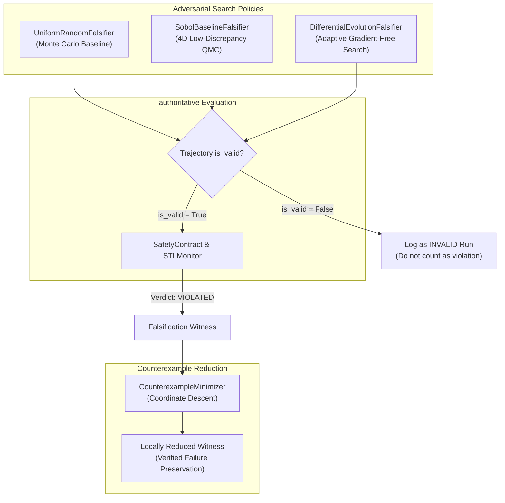

# DÓMNIR V3: Benchmark Protocol and Research Methodology

**Document ID:** RES-BENCHMARK-V3-G2  
**Status:** ACCEPTED (Gate G2 Sign-Off)  
**Lead Author:** Agent A3 (Search & Benchmarks)  
**Co-Authors:** Agent A6 (Evidence & CI), Agent A7 (Guardian & Uncertainty)  
**Reviewer:** Agent A8 (Independent Adversarial QA)  
**Date:** 2026-11-07  

---

## 1. Executive Summary

This protocol formalizes the research benchmark methodology, adversarial search policies, counterexample minimization semantics, and multi-tier verification tiers for Dómnir V3. It eliminates pseudorandom labeling errors, establishes authentic low-discrepancy quasi-Monte Carlo sequences, guarantees honest non-trivial benchmark comparisons, and documents the mathematical bounds of local reduction.

---

## 2. Adversarial Search Policies

To ensure fair empirical evaluation, all three search policies operate over identical bounded 4D parameter spaces ($\mathcal{S} \subset \mathbb{R}^4$):
$$\mathcal{S} = [z_{\min}, z_{\max}] \times [F_{z,\min}, F_{z,\max}] \times [t_{\text{start},\min}, t_{\text{start},\max}] \times [t_{\text{dur},\min}, t_{\text{dur},\max}]$$

### 2.1 Uniform Random Search (`UniformRandomFalsifier`)
- Independent uniform pseudorandom sampling using Python's Mersenne Twister engine.
- Acts as the unguided Monte Carlo baseline.

### 2.2 Authentic Sobol Quasi-Random Sequence (`SobolBaselineFalsifier`)
- Implements Joe & Kuo direction numbers for $d=4$ dimensions using Antonov-Saleev Gray code recurrence:
  - Dimension 0: Identity direction numbers ($v_{0, j} = 1 \ll (31 - j)$)
  - Dimension 1: Primitive polynomial $x + 1$ ($s=1, a=0$)
  - Dimension 2: Primitive polynomial $x^2 + x + 1$ ($s=2, a=1$)
  - Dimension 3: Primitive polynomial $x^3 + x + 1$ ($s=3, a=1$)
- **Digital Shift (Scrambling):** To enable independent statistical replications across random seeds, each dimension undergoes a Cranley-Patterson randomized rotation:
  $$x_d^{(i)} = \left( \hat{x}_d^{(i)} + \Delta_d \right) \bmod 1.0, \quad \Delta_d \sim U(0, 1)$$
  This preserves exact dyadic low-discrepancy stratification while generating distinct sample paths for each seed.

### 2.3 Differential Evolution (`DifferentialEvolutionFalsifier`)
- Adaptive evolutionary algorithm minimizing temporal logic robustness $\rho(\tau)$.
- Population size $N_p = 8$, mutation scale $F = 0.65$, crossover probability $CR = 0.70$.
- Selection strictly replaces parent vectors only when trial robustness is lower ($\rho_{\text{trial}} \le \rho_i$) and valid (`is_valid is True`).

---

## 3. Minimization and Local Reduction Semantics

### 3.1 Terminology and Scientific Scope
Reductions generated by `CounterexampleMinimizer` are designated **locally reduced counterexamples**. Because coordinate descent evaluates local perturbations along one parameter axis at a time, local reduction **does not prove global minimality**.

### 3.2 Reduction Cost Metric
The objective function balances disturbance magnitude, pulse energy, and displacement from nominal mission altitude:
$$C(\mathcal{S}) = |F_z| \cdot \max(0.01, t_{\text{dur}}) + 0.25 \cdot |z_0 - z_{\text{target}}|$$

### 3.3 Admissible Bounds and Independent Verification
- Parameter candidates are clamped to ensure they remain inside valid physical regions ($z_0 \ge 0.05 \text{ m}, t_{\text{dur}} \ge 0.0 \text{ s}$).
- The final reduced candidate undergoes an independent verification evaluation before acceptance, asserting `verified_violation: bool = True`.

---

## 4. Multi-Tier Independent Verification Architecture

Dómnir Court Records are validated across four decoupled, machine-readable tiers without requiring host execution of untrusted code:

| Tier | Name | Scope & Method | Offline? | Allowed Statuses |
|---|---|---|---|---|
| **L0** | Structural Integrity | Canonical JSON parsing, SHA-256 schema hashes, limitations check, event log hash chain verification. | Yes | `PASS`, `FAIL`, `INCOMPLETE` |
| **L1** | Physics Replay | Replays recorded action vectors through trusted MuJoCo physics model. Verifies trajectory hash matches within $10^{-12}$ m tolerance. | Yes | `PASS`, `FAIL`, `INCOMPLETE` |
| **L2** | Controller Determinism | Reruns controller inside verified MicroVM (`/dev/kvm`). Verifies action determinism against recorded trace. Fails closed when sandbox unavailable. | Opt-in | `PASS`, `FAIL`, `UNAVAILABLE`, `NOT_RUN` |
| **L3** | Containment Audit | Audits event log timestamps, host execution sources, and cleanup confirmation. | Yes | `PASS`, `FAIL`, `INCOMPLETE`, `NOT_RUN` |

Default verification (CLI and REST API) evaluates tiers L0 and L1 safely offline without code execution.
