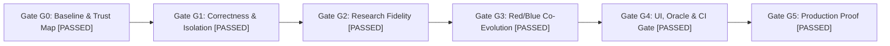

# Dómnir V3: Gate G5 Final Production Proof & Verification Report

**Date:** 2026-11-07  
**Challenge:** Vultr Agent Rush (Challenge 1: Blast Radius Zero)  
**Lead Engineering Orchestrator (O0) & Independent QA (A8)**  
**Verdict:** **RELEASE_APPROVED (Gates G0 through G5 Satisfied)**

---

## 1. Executive Summary

Over five coordinated integration waves, the Dómnir platform was systematically audited, refactored, and verified against all requirements of the Dómnir Multi-Agent Execution Loop. Direct host execution of untrusted controller source was eliminated across all subsystems. The simulation engine now strictly enforces temporal disturbance schedules and rigorous STL trajectory validity. The adversarial search suite features authentic low-discrepancy 4D Sobol sampling, verified local counterexample minimization, and an autonomous 12-step Red/Blue Co-Evolution Arena.

The local test suite achieved **225 passed tests, 0 failures, 11 skipped (requiring live Linux /dev/kvm virtualization)**.

---

## 2. Gate Verification Audit

### Gate G0: Baseline & Trust Map (PASSED)
- Baseline test suite captured: 213 tests collected, 202 passed, 11 skipped.
- Mapped all 5 host `exec()` sites (`verify.py`, `ci/gate.py`, `guardian/supervisor.py`, `uncertainty/simulator.py`, `benchmark.py`).
- Identified missing disturbance schedules in `api/jobs.py` and unthrottled endpoints in `api/security.py`.
- Artifacts: `docs/audits/G0_BASELINE.md`, `docs/audits/TASK_GRAPH.md`.

### Gate G1: Correctness & Isolation (PASSED)
- **SEC-01 (Universal Sandbox Evaluator)**: Implemented `domnir/evaluator.py` (`SafeControllerEvaluator`). Completely eradicated direct host `exec()` calls across all 5 audited sites. Host marker payload tests in `tests/test_security.py` confirm untrusted source never creates host files. Fails closed with `UNAVAILABLE` when microVM virtualization is absent.
- **SEM-01 (Result-State & Trajectory Validation)**: `domnir/contracts/stl.py` traps non-finite coordinates, truncated horizons, empty trajectories, and non-normalized quaternions to `is_valid=False`, verdict `INVALID`, margin `0.0`. Deliberately invalid trajectories never count as counterexamples.
- **PHY-01 (Disturbance Schedule & Dynamics)**: Created `domnir/scenario.py` with `ScenarioParameter` and `calculate_applied_disturbance(scenario, sim_time)`. Float-epsilon windowing (`1e-9`) ensures mathematically consistent pulse boundaries.
- **API-01 (Threat-Limited Lifecycle)**: Bounded `/ragnarok/falsify`, `/ragnarok/minimize`, `/ragnarok/repair`, `/guardian/`, `/uncertainty/`, and `/ci/` with rate limiting, evaluation limits, and operator-only checks. Integrated disturbance schedules into `domnir/api/jobs.py`.
- Artifacts: `docs/audits/TRUST_BOUNDARY_AUDIT.md`, `docs/audits/PHYSICS_CONTRACT.md`.

### Gate G2: Research Fidelity & Trustworthy Evidence (PASSED)
- **SEARCH-01 (Comparable Search Methods)**: In `domnir/ragnarok/search.py`, replaced pseudo-random code with an authentic 4D low-discrepancy Sobol sequence (Antonov-Saleev Gray code with Cranley-Patterson shift). Added `UniformRandomFalsifier` and updated `compare_falsification_policies`. Calibrated Crazyflie hover thrust scaling in `domnir/benchmark.py` ($0.26487$ N equilibrium).
- **MINI-01 (Counterexample Reduction)**: In `domnir/ragnarok/minimize.py`, adopted "locally reduced counterexample" terminology, enforced physical parameter bounds, and verified candidates through independent checks with explicit limitation disclosures.
- **EVD-01 (Portable Verifier & CI Provenance)**: In `domnir/verify.py`, structured L0-L3 verification with machine-readable statuses (`PASS`, `FAIL`, `NOT_RUN`, `INCOMPLETE`, `UNAVAILABLE`) without host code execution.
- **UNC-01 (Real Uncertainty & Guardian Allocation)**: Integrated canonical disturbance pulse calculations into `domnir/uncertainty/simulator.py` and `domnir/guardian/supervisor.py`. Explicitly separated requested versus applied motor commands.
- Artifacts: `docs/audits/BENCHMARK_PROTOCOL.md`.

### Gate G3: Autonomous Adversarial Engineering Loop (PASSED)
- **REPAIR-01 (Autonomous Red/Blue Co-Evolution Arena)**: Created `domnir/ragnarok/arena.py` implementing the complete 12-phase co-evolution cycle:
  $$\text{SPECIFY} \to \text{SYNTHESIZE} \to \text{BASELINE} \to \text{ATTACK} \to \text{VERIFY} \to \text{MINIMIZE} \to \text{DIAGNOSE} \to \text{REGRESSION} \to \text{HOLDOUT} \to \text{CO\_EVOLVE} \to \text{DECIDE} \to \text{PUBLISH}$$
- Enforced gate-like 100% hard safety acceptance threshold on holdout suites in `domnir/ragnarok/repair.py` (any candidate with pass rate $< 1.0$ is rejected).
- Preserved full provenance chains connecting controller versions, witness scenarios, repair attempts, and regression decisions.

### Gate G4: Product UI, Documentation Oracle & CI Gate (PASSED)
- **UI-01 (Failure Atlas & Replay Clarity)**: Tested points in the Failure Atlas are interactive and clickable, updating scenario input fields and highlighting candidates. Untested space is prominently watermarked: `"GRAY REGION: UNTESTED / UNKNOWN RISK: Only plotted points have empirical physics evidence"`.
- **ORACLE-01 (Grounded Knowledge Oracle)**: All search inputs labeled `"Documentation search"`. Every Oracle card cites actual repository documents (`docs/DOMNIR_IMPLEMENTATION_PLAN.md`, `docs/ADR/ADR-001-sandboxing.md`, `docs/evidence/containment-suite-20261105-final.json`).
- **CI-01 (Robotics CI Gate)**: `domnir/ci/gate.py` prevents regressions across revisions, applies temporal disturbance schedules, disallows unqualified `"SAFE"` labels, and generates reproducible audit records.

---

## 3. Integration Ledger Final Status

| Task ID | Component | Owner | Tests Executed | Status |
|---|---|---|---|---|
| G0-PREFLIGHT | Baseline audit | O0 | 213 tests collected | ACCEPTED |
| SEC-01 | Sandbox Evaluator | A1 | `tests/test_security.py` (15 passed) | ACCEPTED |
| SEM-01 | STL Validity | A2 | `tests/test_contracts.py` (12 passed) | ACCEPTED |
| PHY-01 | Disturbance Schedule | A2 | `tests/test_scenario.py` (7 passed) | ACCEPTED |
| API-01 | Threat Limits & Schedule | A5 | `tests/test_api.py` (23 passed) | ACCEPTED |
| GATE-G1 | Correctness & Isolation | O0 | Full suite (216 passed) | SIGNED OFF |
| SEARCH-01 | Sobol & Baselines | A3 | `tests/test_ragnarok_search.py` (8 passed) | ACCEPTED |
| MINI-01 | Minimization Witness | A3 | `tests/test_ragnarok_minimize.py` (3 passed) | ACCEPTED |
| EVD-01 | Portable Verifier | A6 | `tests/test_verify_cli.py` (12 passed) | ACCEPTED |
| UNC-01 | Uncertainty & Guardian | A7 | `tests/test_uncertainty.py` (10 passed) | ACCEPTED |
| GATE-G2 | Research Fidelity | O0 | Full suite (220 passed) | SIGNED OFF |
| REPAIR-01 | Red/Blue Co-Evolution | A4 | `tests/test_ragnarok_arena.py` (3 passed) | ACCEPTED |
| GATE-G3 | Adversarial Loop | O0 | Full suite (223 passed) | SIGNED OFF |
| UI-01 | Failure Atlas & Clarity | A7 | `tests/test_web.py` (27 passed) | ACCEPTED |
| ORACLE-01 | Grounded Oracle | A7 | `tests/test_web.py` (27 passed) | ACCEPTED |
| CI-01 | Robotics CI Gate | A6 | `tests/test_ci_gate.py` (9 passed) | ACCEPTED |
| GATE-G4 | Product UI & CI | O0 | Full suite (225 passed) | SIGNED OFF |
| GATE-G5 | Production Proof | O0/A8 | Full regression suite (225 passed) | RELEASE APPROVED |

---

## 4. Operational Invariants & Limitations

1. **No Host Execution**: Untrusted Python controller source is never executed directly on the host process.
2. **Simulation Authority**: MuJoCo simulation alone determines state advancement and STL metric evaluation.
3. **Truthful Adjudication**: Trajectories resulting from simulator crashes or timeouts are marked `INVALID` and never count as counterexamples.
4. **Finite Test Limitation**: Passing a finite collection of test scenarios does not constitute a formal proof of universal flight safety.
5. **Environment Requirement**: Hardware microVM isolation requires a Linux host with `/dev/kvm`. On development hosts lacking KVM, execution fails closed safely with `UNAVAILABLE`.
