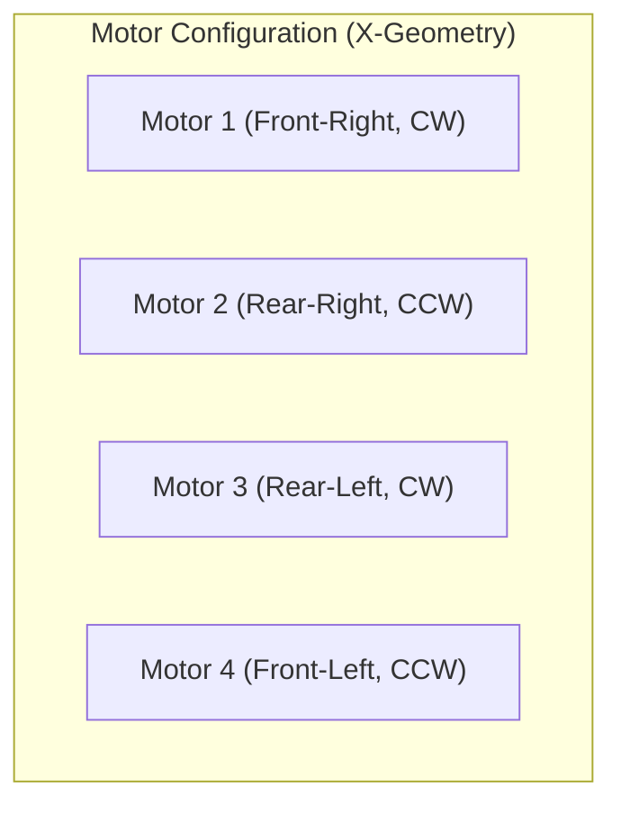
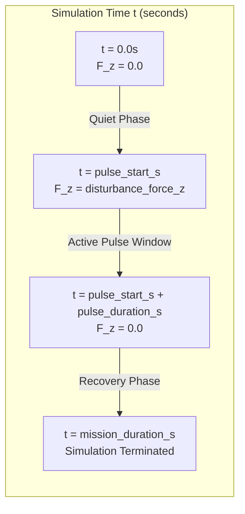
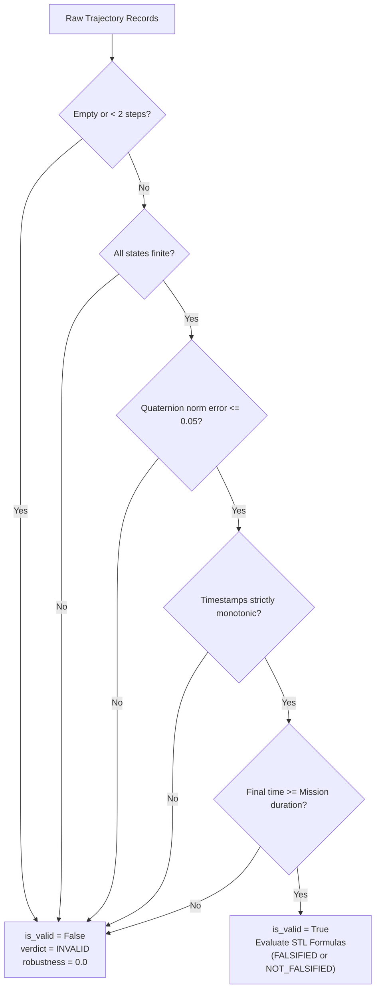

# DÓMNIR V3: Physics Contract and Safety Semantics Specification

**Document ID:** PHY-CONTRACT-V3-G1  
**Status:** ACCEPTED (Gate G1 Sign-Off)  
**Lead Author:** Agent A2 (Physics & Safety Contracts)  
**Reviewer:** Agent A8 (Independent Adversarial QA)  
**Date:** 2026-11-07  

---

## 1. Executive Summary

This specification establishes the authoritative physical and semantic contracts governing Dómnir V3. It defines the actuator protocols, observation spaces, coordinate frames, control frequencies, disturbance pulse schedules, and strict validity criteria for the Bitcraze Crazyflie 2.0 quadrotor simulated within MuJoCo.

Crucially, semantic validity rules ensure that simulator artifacts, execution crashes, timeouts, non-monotonic timestamps, and unnormalized quaternions evaluate to `is_valid=False` with verdict `INVALID`, preventing corrupted runs from masquerading as physical counterexamples.

---

## 2. Platform & Physical Constants

The physical model is derived from the Bitcraze Crazyflie 2.0 system dynamics:

| Parameter | Symbol | Value | Unit | Description |
|---|---|---|---|---|
| Total Mass | $m$ | $0.027$ | $\text{kg}$ | Nominal drone mass (27 grams) |
| Arm Length | $L$ | $0.046$ | $\text{m}$ | Distance from center of mass to motor shaft |
| Inertia Tensor ($I_{xx}, I_{yy}$) | $I_{xx}, I_{yy}$ | $1.65717 \times 10^{-5}$ | $\text{kg}\cdot\text{m}^2$ | Principal rotational inertia |
| Inertia Tensor ($I_{zz}$) | $I_{zz}$ | $2.92616 \times 10^{-5}$ | $\text{kg}\cdot\text{m}^2$ | Polar rotational inertia |
| Gravity Acceleration | $g$ | $9.81$ | $\text{m}/\text{s}^2$ | Downward gravitational acceleration |
| Thrust-to-Weight Ratio | $T/W$ | $\approx 2.26$ | - | Peak total thrust / gravitational force |

---

## 3. Actuator Protocol & Control Bounds

The Crazyflie 2.0 utilizes 4 brushed coreless DC motors with fixed-pitch micro propellers in an "X" configuration:



### 3.1 Action Bounds
Each actuator is commanded via individual rotor thrust forces:
$$u_i \in [u_{\min}, u_{\max}] = [0.0, 0.15] \quad \text{Newtons (per rotor)}$$
- Total nominal hover thrust required: $F_{\text{hover}} = mg = 0.027 \times 9.81 \approx 0.26487 \text{ N}$
- Hover thrust per motor: $u_{\text{hover}, i} \approx 0.06622 \text{ N}$
- Peak thrust across 4 motors: $4 \times 0.15 = 0.60 \text{ N}$

Action vectors received from untrusted controllers are clamped and validated deterministically:
```python
action = parse_action(raw_bytes, trial_id=exp_id, step_index=k, bounds=ActionBounds(0.0, 0.15))
```

---

## 4. Coordinate Frames & Conventions

### 4.1 World Frame
- **Convention:** Right-handed North-West-Up (NWU / Z-up).
- **Origin ($[0, 0, 0]$):** Floor level at the designated takeoff center.
- **Altitude ($z$):** Positive upwards along the vertical axis.

### 4.2 Body Frame
- **Origin:** Center of Mass (CoM) of the Crazyflie airframe.
- **X-axis ($+x$):** Forward through the airframe nose.
- **Y-axis ($+y$):** Left wing / port side.
- **Z-axis ($+z$):** Normal to rotor plane, pointing upwards.

### 4.3 Orientation Representation
- **Quaternion Convention:** Unit quaternion $[q_w, q_x, q_y, q_z]$ where $q_w$ is the scalar real part.
- **Identity Orientation:** $[1.0, 0.0, 0.0, 0.0]$ indicates zero roll, pitch, and yaw.
- **Normalization Constraint:** A valid physical orientation must satisfy unit norm within tolerance:
  $$\left| \sqrt{q_w^2 + q_x^2 + q_y^2 + q_z^2} - 1.0 \right| \le 0.05$$
  Violations indicate numerical divergence or corrupted telemetry, triggering an immediate `INVALID` verdict.

---

## 5. Temporal Contracts & Integration

- **Simulation Engine:** MuJoCo Physics Engine (`mujoco.mj_step`).
- **Control & Integration Timestep:** $\Delta t = 0.002 \text{ s}$ ($500 \text{ Hz}$).
- **Integrator:** Runge-Kutta 4th order (RK4) or implicit Euler configured in MuJoCo.
- **Settling Time ($t_{\text{settle}}$):** Default $0.15 \text{ s}$. Violations during the transient window $t \in [0, t_{\text{settle}})$ are ignored for asymptotic tracking specifications, provided safety bounds ($z_{\min}, z_{\max}$) are not breached.

---

## 6. Disturbance Schedule Specification ($F_z$)

Physical stress testing applies vertical aerodynamic disturbances (downbursts, gusts, payload releases) to the airframe center of mass.

### 6.1 Parameterized Disturbance Model
A disturbance scenario is parameterized by a tuple:
$$\mathcal{S} = (\text{initial\_altitude\_m}, F_{z,\text{applied}}, t_{\text{start}}, t_{\text{duration}})$$

### 6.2 Float-Epsilon Pulse Windowing
To eliminate boundary-point floating point rounding jitter, disturbance force is scheduled via:
$$F_z(t) = \begin{cases} 
F_{z,\text{applied}} & \text{if } (t_{\text{start}} - 10^{-9}) \le t < (t_{\text{start}} + t_{\text{duration}} - 10^{-9}) \\
0.0 & \text{otherwise}
\end{cases}$$
When $t_{\text{start}} = 0.0$ and $t_{\text{duration}} = 0.0$, the disturbance operates in legacy continuous mode, applying $F_{z,\text{applied}}$ continuously for the full trajectory duration.



---

## 7. Semantic Validity & Falsification Rules

A core principle of Dómnir is: **An invalid experiment cannot be an adversarial counterexample.**

### 7.1 Hard Validity Checks
During trajectory evaluation, `STLMonitor.evaluate_trajectory` executes five strict validity gates before computing robustness scores:

1. **Non-Empty Trajectory:** Trajectory record list must contain at least 2 frames ($k \ge 2$).
2. **Finite Values:** All coordinates ($x, y, z$), velocities ($v_x, v_y, v_z$), and quaternions must be strictly finite (`np.isfinite`).
3. **Quaternion Norm:** All orientation frames must satisfy $|\|q\| - 1.0| \le 0.05$.
4. **Monotonic Timestamps:** Simulation time must strictly increase ($t_{k} > t_{k-1}$).
5. **Full Horizon:** The final timestamp must reach or exceed the expected mission duration ($t_{\text{final}} \ge t_{\text{mission}} - \Delta t$).



### 7.2 Falsifier Filtering
Adversarial search algorithms (`SobolBaselineFalsifier`, `DifferentialEvolutionFalsifier`) evaluate `is_valid`. If `res.is_valid is False`:
- The candidate scenario is logged as an invalid execution sample.
- The iteration is **never** registered as a violation or counterexample.
- The global counterexample witness is **not** overwritten.
- Search continues until a genuine physical contract violation is demonstrated.
