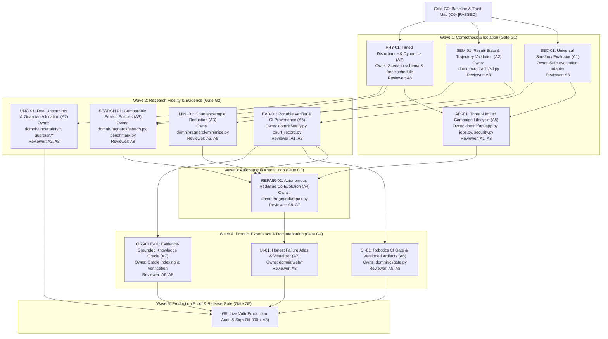

# Dómnir V3: Task Dependency Graph and Specialist Allocation

## Task Specifications and Exit Criteria

### 1. SEC-01: Universal Sandbox Evaluator
- Owner: Agent A1 (Security & Isolation)
- Reviewer: Agent A8 (Independent QA)
- Target: Create a secure typed evaluation adapter (`domnir/evaluator.py` or `domnir/sandbox.py`) that strictly prohibits host execution of untrusted controller code. Ensure static analysis is used for offline verification (L0), and verified sandboxes are used for live evaluation.
- Exit Criteria: Zero host `exec` or `eval` calls in production execution paths; malicious payload test does not execute on host; fails closed with `UNAVAILABLE` when sandbox is absent.

### 2. SEM-01: Result-State and Trajectory Validation
- Owner: Agent A2 (Physical Semantics & Contracts)
- Reviewer: Agent A8 (Independent QA)
- Target: Update `domnir/contracts/stl.py` so that empty, non-finite, truncated, or timed-out trajectories produce `verdict="INVALID"`, `satisfied=False`, and a distinct non-numeric sentinel or finite invalid flag, never serialized as `-inf` or counted as a physical falsification witness.
- Exit Criteria: 5 invalid trajectories produce 0 counterexample witnesses and 5 invalid counts; non-finite states are properly trapped.

### 3. PHY-01: Timed Disturbance Schedule and Dynamics Semantics
- Owner: Agent A2 (Physical Semantics & Contracts)
- Reviewer: Agent A8 (Independent QA)
- Target: Formalize `ScenarioParameter` into a single validated trusted scenario schema. Provide disturbance schedule calculator evaluating force as a function of simulation time: $F_z(t) = F_{dist}$ for $t \in [t_{start}, t_{start} + t_{dur}]$, else $0.0$.
- Exit Criteria: Two scenarios with identical magnitude but non-overlapping pulse windows produce measurably distinct applied force profiles and state trajectories; replay reproduces identical schedule.

### 4. API-01: Threat-Limited Campaign Lifecycle and Force Schedule Integration
- Owner: Agent A5 (API & Orchestration)
- Reviewer: Agent A1 (Security), Agent A8 (Independent QA)
- Target: Integrate disturbance schedule into `domnir/api/jobs.py` and `domnir/api/app.py`. Apply campaign-level evaluation limits, wall-clock timeouts, visitor rate limits, and sanitize `X-Forwarded-For` trust. Require operator authorization for privileged endpoints even if unset.
- Exit Criteria: Rate limit cannot be bypassed with forged IP headers; unauthenticated judge can run normal experiments; privileged containment requires operator token; campaign budgets are strictly enforced.

### 5. SEARCH-01: Comparable Search Methods
- Owner: Agent A3 (Search & Benchmarks)
- Reviewer: Agent A8 (Independent QA)
- Target: Separate Uniform Random sampling and authentic Sobol quasi-random sampling in `domnir/ragnarok/search.py`. Account for invalid evaluations separately from valid ones. Establish nontrivial benchmark scenario where first evaluation does not immediately falsify.
- Exit Criteria: Sobol samples exhibit low-discrepancy properties; Random is labeled honestly; valid evaluations are counted accurately; invalid runs do not count as violations.

### 6. MINI-01: Counterexample Reduction
- Owner: Agent A3 (Search & Benchmarks)
- Reviewer: Agent A2 (Physics), Agent A8 (Independent QA)
- Target: Refine `domnir/ragnarok/minimize.py` to label outcomes as locally reduced counterexamples. Validate that reduced parameters stay within admissible envelope and retain violation verdict upon independent re-evaluation.
- Exit Criteria: Reduced scenario preserves failure predicate without going out of bounds; reduction report details initial and final values.

### 7. EVD-01: Portable Verifier and CI Provenance
- Owner: Agent A6 (Court Records & CI)
- Reviewer: Agent A1 (Security), Agent A8 (Independent QA)
- Target: Make `domnir/verify.py` safe by default (L0 structure and L1 recorded-action replay do not execute controller code). L2 controller rerun calls approved sandbox adapter only when requested. Replace synthetic Court Record hashes with authentic evidence hashes.
- Exit Criteria: Untrusted source in Court Record cannot execute during default verification; tampering fails L0; L2 without sandbox returns `UNAVAILABLE`.

### 8. UNC-01: Real Uncertainty and Guardian Allocation
- Owner: Agent A7 (Guardian & Uncertainty)
- Reviewer: Agent A2 (Physics), Agent A8 (Independent QA)
- Target: Remove heuristic guessing in `domnir/guardian/supervisor.py`; adhere to canonical actuator schema `(body_thrust, x_moment, y_moment, z_moment)`. Ensure `domnir/uncertainty/simulator.py` only scales thrust on the thrust channel, not moments.
- Exit Criteria: Controlled mass and latency variations produce directionally correct physical response; Guardian preserves motor allocation without guessing.

### 9. REPAIR-01: Autonomous Red/Blue Co-Evolution
- Owner: Agent A4 (Autonomous Repair & Arena)
- Reviewer: Agent A8 (Independent QA)
- Target: Update `domnir/ragnarok/repair.py` to enforce gate-like hard safety acceptance (100% pass on acceptance holdout suite). Incorporate fresh Red attack after Blue repair. Maintain controller lineage and version history.
- Exit Criteria: Candidate failing any hard safety holdout is rejected; successful repair is challenged with fresh adversarial search; full lineage recorded.

### 10. UI-01 & ORACLE-01: Transparent Failure Atlas, 3D Replay, and Verified Oracle
- Owner: Agent A7 (Visualization & Oracle)
- Reviewer: Agent A8 (Independent QA), Agent A6 (Court Records)
- Target: Ensure Failure Atlas clearly distinguishes tested points from untested regions. 3D replay visualizes real trajectory coordinates and pulse schedule. Oracle citations match real repository files.
- Exit Criteria: No phantom citations; untested areas marked unknown; responsive layout passes 390px to 1440px.

### 11. CI-01: Robotics CI Gate with Verified Artifacts
- Owner: Agent A6 (Court Records & CI)
- Reviewer: Agent A5 (API), Agent A8 (Independent QA)
- Target: Ensure `domnir/ci/gate.py` requires real artifacts and reports truthful release gating without unqualified safe claims.
- Exit Criteria: Passing revision receives `RELEASE_APPROVED`; regression receives `REGRESSION_FOUND`; missing evidence receives `BLOCKED_INCOMPLETE`.

### 12. G5: Production Proof and Release Gate
- Owner: Agent O0 (Lead Orchestrator) & Agent A8 (Independent QA)
- Target: Execute end-to-end judge journey on live Vultr instance with microVM isolation and live Vultr Serverless Inference. Verify Court Record generation and independent CLI verification.
- Exit Criteria: All 30 required test scenarios (T01-T30) pass or document verified environment status. Zero open P0 defects.
