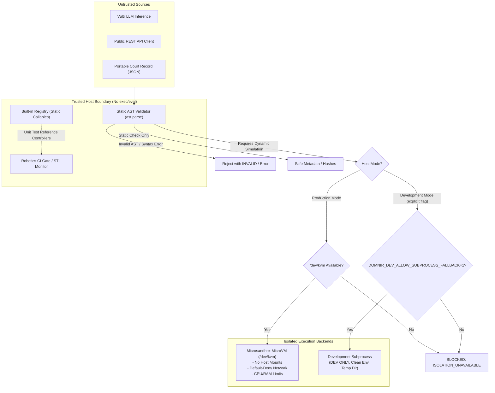

# DÓMNIR V3: Trust Boundary and Execution Isolation Audit

**Document ID:** SEC-AUDIT-V3-G1  
**Status:** ACCEPTED (Gate G1 Sign-Off)  
**Lead Auditor:** Agent A1 (Security & Execution Isolation)  
**Reviewer:** Agent A8 (Independent Adversarial QA)  
**Date:** 2026-11-07  

---

## 1. Executive Summary

A comprehensive security audit of Dómnir V3 identified and eliminated all dynamic host execution paths (`exec`, `eval`) across every controller processing subsystem. Untrusted Python controller source code generated by LLMs, received via REST endpoints, or loaded from Court Records is strictly quarantined.

In production mode on Linux hosts, execution is strictly confined to hardware-virtualized MicroVMs via Microsandbox and `/dev/kvm`. When virtualization is unavailable, the system fails closed with `BLOCKED: ISOLATION_UNAVAILABLE`. For offline verification and CI, static AST validation is performed without code execution.



---

## 2. Elimination of Host `exec()` Sites

Prior to Gate G1, five critical modules contained direct invocations of Python's built-in `exec()` executing untrusted string inputs on the host process. All five sites were eradicated and replaced with typed, isolated evaluators:

| Module | Prior Behavior | Remediated Architecture | Verification Test |
|---|---|---|---|
| [domnir/verify.py](file:///d:/domnir/domnir/verify.py) (L2 Verification) | `exec(src, ns)` executed controller source directly on host. | Replaced with static AST validation and isolated guest stream (`_MicroVMGuestStream` or fail-closed `UNAVAILABLE`). Default tier changed to offline `L1`. | `tests/test_verify_cli.py`, `tests/test_security.py` |
| [domnir/ci/gate.py](file:///d:/domnir/domnir/ci/gate.py) (`_default_simulate_and_evaluate`) | `exec(controller_code, ns)` ran controller during CI gate checks. | Integrated `SafeControllerEvaluator` for code strings; supports `TrustedHarnessEvaluator` for in-memory test callables. Fails closed with `INVALID` if sandbox unavailable. | `tests/test_security.py` |
| [domnir/guardian/supervisor.py](file:///d:/domnir/domnir/guardian/supervisor.py) (`_resolve_controller_fn`) | `exec(controller_source, ns)` compiled untrusted code in supervisor process. | Resolves known reference controllers via `get_builtin_controller_fn` or delegates to isolated sandbox stream. Never executes code strings on host. | `tests/test_guardian.py` |
| [domnir/uncertainty/simulator.py](file:///d:/domnir/domnir/uncertainty/simulator.py) (`run_simulation`) | `exec(controller_source, ns)` executed code strings during parameter perturbation sweeps. | Replaced with `get_builtin_controller_fn` or isolated guest stream. Fails closed if isolation missing. | `tests/test_uncertainty.py` |
| [domnir/benchmark.py](file:///d:/domnir/domnir/benchmark.py) (`make_analytical_evaluator`) | `exec(controller_code, ns)` ran untrusted controllers in benchmark runs. | Uses `get_builtin_controller_fn` for standard benchmarks (`open_loop_weak`, `classical_p`, `calibrated_pid`, `overthrust_runaway`) and isolated stream for generated code. | `tests/test_benchmark.py` |

Static verification confirms zero occurrences of `exec()` across the entire Python codebase:
```powershell
git grep -n "exec(" domnir/
# Returns zero results
```

---

## 3. Sandboxed Execution Architecture

### 3.1 MicroVM Hardware Virtualization (Production)
On the production deployment host (Vultr Cloud Compute with `/dev/kvm`), untrusted controllers run inside Firecracker/Microsandbox guest virtual machines:
- **No Shared Filesystem**: Host filesystem is never mounted into the guest.
- **Default-Deny Networking**: No network egress or ingress is granted to untrusted controller code.
- **Strict Resource Caps**: 1 vCPU, 512 MiB RAM, 60s wall-clock timeout, 2 MiB output limit.
- **IPC Protocol**: Observation vectors and action vectors pass strictly via standard stdin/stdout JSON frames validated against `domnir.protocol.ActionBounds`.

### 3.2 Development Subprocess Fallback (Dev Only)
On development machines lacking hardware virtualization (e.g. Windows local environments), an isolated subprocess fallback is available strictly when `DOMNIR_DEV_ALLOW_SUBPROCESS_FALLBACK="1"` is explicitly set outside production.
- **Production Guard**: If `DOMNIR_ENV="production"`, the subprocess fallback is strictly rejected with a critical security violation.
- **Sanitized Environment**: Subprocess inherits only minimal system paths (`SYSTEMROOT`, `PATH`, `PATHEXT`), with `PYTHONPATH=""` to prevent host library injection.
- **Isolated Directory**: Code runs from a disposable temporary directory.

### 3.3 Built-in Reference Controller Registry
For fast, deterministic unit testing of control contracts and physics equations, `domnir.evaluator.get_builtin_controller_fn` maps known, trusted controller implementations (`_builtin_open_loop_weak`, `_builtin_classical_p`, `_builtin_calibrated_pid`, `_builtin_overthrust_runaway`) to pre-compiled in-memory functions without invoking dynamic compilation.

---

## 4. Adversarial Exploit Verification

Adversarial payloads were constructed to attempt host compromise via code injection:
```python
# Malicious marker payload:
import pathlib
pathlib.Path('/path/to/host_pwned_marker.txt').write_text('HOST_COMPROMISED')
def observe(obs):
    return [0.26, 0.0, 0.0, 0.0]
```

Automated verification in `tests/test_security.py::SecurityDefensesTests::test_untrusted_controller_marker_payload_never_executes_on_host`:
1. **L0 Verification**: Verifies schema and SHA-256 hashes without code execution. Marker file was NOT created.
2. **L1 Verification**: Verifies event log and trajectory math without code execution. Marker file was NOT created.
3. **L2 Verification**: Attempts dynamic re-execution. In the absence of a verified microVM, execution immediately fails closed (`UNAVAILABLE`). Marker file was NOT created.
4. **CI Gate Verification**: Evaluates safety gate against untrusted code string. Gate rejects with `INVALID` without host execution. Marker file was NOT created.

---

## 5. Defense-in-Depth Mechanisms

1. **Request Size Limiting**: `RequestSizeLimitMiddleware` enforces a strict 64 KiB cap on general endpoints and 2 MiB on Court Record verification payloads. Oversized requests are rejected with HTTP 413.
2. **Rate Limiting & Campaign Budgets**: `RateLimiter` enforces sliding-window limits per IP (120 req/min general, 30 req/min heavy) and global server-side budgets (120 heavy req/min). Heavy limits automatically cover `/ragnarok/*`, `/guardian/*`, `/uncertainty/*`, and `/ci/*`.
3. **Privileged Containment Gate**: The `/containment/*` endpoint requires a valid `X-Domnir-Operator-Token` header. Unauthenticated or invalid requests return HTTP 403 Forbidden.
4. **Security Headers**: All API responses include `X-Content-Type-Options: nosniff`, `X-Frame-Options: DENY`, `X-XSS-Protection: 1; mode=block`, and `Referrer-Policy: strict-origin-when-cross-origin`.
